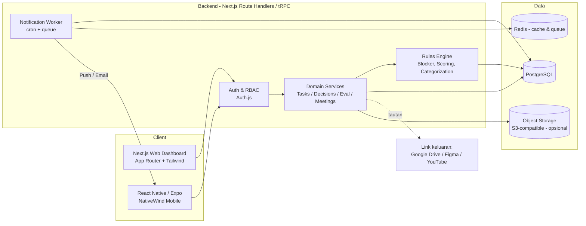
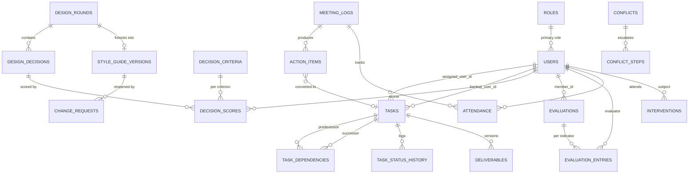
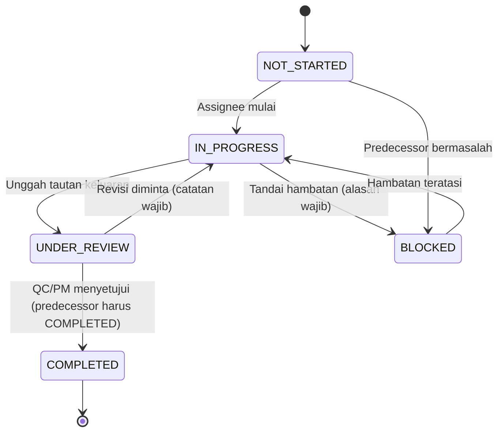
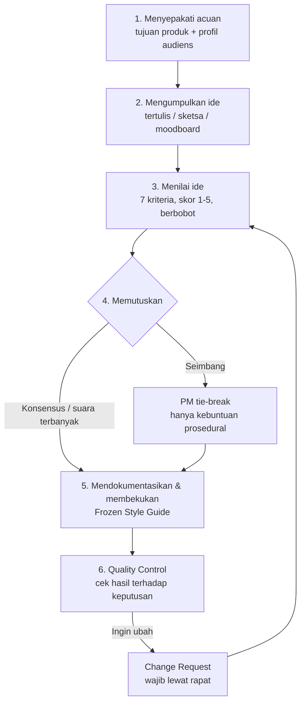
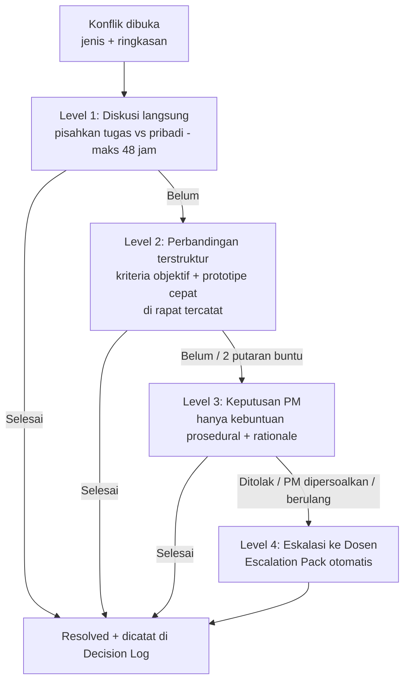

# DESIGN.md - Multimedia Team Collaboration & Project Tracker

| | |
|---|---|
| **Dokumen** | Design Document & Product Requirements (PRD) |
| **Produk** | Multimedia Team Collaboration & Project Tracker ("MediaSync" — nama kerja) |
| **Versi** | 1.0 (Draft siap implementasi) |
| **Tanggal** | 3 November 2026 |
| **Pemilik** | Lead Software Architect · Principal Product Manager · Senior UI/UX Designer |
| **Target pengguna** | Kelompok produksi multimedia beranggotakan 5 orang (konteks tugas perkuliahan) |
| **Platform** | Web Dashboard (Next.js) + Mobile (React Native) |

> **Catatan asumsi.** Dokumen ini diturunkan dari studi kasus diskusi dosen, bukan dari proyek yang benar-benar berjalan. Seluruh angka (mis. "2 dari 5 anggota aktif") adalah rekonstruksi dari deskripsi kasus, bukan pengukuran lapangan. Jenis produk tidak disebutkan, sehingga sistem mengasumsikan **video pendek atau konten digital campuran** (teks, grafis, audio, video). Penyebab ketidakaktifan tiap anggota juga masih **dugaan**; karena itu sistem dirancang untuk *mendiagnosis penyebab terlebih dahulu*, bukan langsung menghukum.

---

## Daftar Isi

1. [Project Overview & Objectives](#1-project-overview--objectives)
2. [System Architecture & Tech Stack (Web & Mobile)](#2-system-architecture--tech-stack-web--mobile)
3. [Design System & UI/UX Guidelines](#3-design-system--uiux-guidelines)
4. [Roles & Responsibilities Matrix](#4-roles--responsibilities-matrix-5-peran-utama)
5. [Core Modules & Features Workflow](#5-core-modules--features-workflow)
6. [Implementation Guidelines & Component Blueprints](#6-implementation-guidelines--component-blueprints)
7. [Appendix: Roadmap, Risiko, Acceptance Criteria, Traceability](#7-appendix)

---

## 1. Project Overview & Objectives

### 1.1 Latar Belakang & Masalah

Kelompok produksi multimedia terdiri atas lima anggota yang mengerjakan produk dengan **tiga tahap saling bergantung**: Pra-Produksi → Produksi → Pasca-Produksi. Keterlambatan atau ketidaksepakatan di satu tahap langsung menggeser tahap berikutnya (contoh: naskah terlambat → storyboard tertunda → aset belum bisa diproduksi → editing tertunda → QC terpotong → finalisasi berisiko terlambat).

Studi kasus menunjukkan tiga gejala utama:

1. **Partisipasi tidak merata** — hanya 2 dari 5 anggota aktif.
2. **Keterlambatan** — satu anggota sering terlambat mengumpulkan tugas.
3. **Kebuntuan ide visual** — satu anggota punya ide berbeda sehingga kesepakatan sulit dicapai (kelompok terjebak di tahap *storming* menurut Tuckman, 1965, tanpa masuk *norming*).

Ketiga gejala dipetakan menjadi **empat kategori masalah** yang saling memperkuat, dan setiap kategori diterjemahkan menjadi fitur produk:

| Kategori Masalah | Akar Masalah (dugaan) | Teori Pendukung | Respons Produk (Modul) |
|---|---|---|---|
| **Struktur** | Tidak ada pembagian peran formal; sebagian anggota tidak tahu tugasnya atau keterampilannya tidak cocok | Saling ketergantungan sosial (Johnson & Johnson, 2009) | Role assignment, Task Board dengan penanggung jawab & keluaran wajib (M2) |
| **Akuntabilitas** | Kontribusi individu tidak terlihat sehingga muncul *social loafing* | Latané dkk. (1979) | Contribution ledger, Peer Evaluation, Intervention Ladder (M1, M4) |
| **Proses Keputusan** | Ide dikumpulkan sebelum tujuan & audiens disepakati; tidak ada kriteria penilaian | Kreativitas sebagai hasil konteks (Amabile, 1996; Sawyer, 2012) | Design Decision Matrix & Frozen Style Guide (M3) |
| **Komunikasi** | Tidak ada notulen, catatan keputusan, saluran & jadwal komunikasi; kesepakatan mudah dibuka kembali | Robbins & Judge (2017); Tuckman (1965) | Meeting Log, Decision Log, Conflict Escalation (M5) |

Prinsip kunci yang membedakan produk ini dari task manager generik:

- **Diagnosis sebelum sanksi.** Tiga anggota tidak aktif belum tentu punya penyebab yang sama (tidak diberi tugas, keterampilan tidak cocok, atau memang mengandalkan orang lain). Teguran yang salah sasaran justru memperkuat ketidakaktifan. Sistem memaksa urutan: *tanya kendala → sesuaikan beban → baru teguran*.
- **Acuan sebelum ide.** Tujuan produk & profil audiens harus dikunci sebelum ide dinilai.
- **Keputusan mengikat.** Keputusan desain dibekukan dan hanya bisa dibuka lewat rapat yang tercatat.

### 1.2 Tujuan Utama

| # | Tujuan | Cara Sistem Mencapainya |
|---|---|---|
| O1 | **Transparansi tugas** — siapa mengerjakan apa, kapan, dan apa keluarannya selalu terlihat | Task Board dengan assignee, status, tenggat ganda (internal & resmi), URL keluaran wajib |
| O2 | **Ketergantungan antar-tahap lancar** | Dependency graph antartugas, *red-flag blocker alert*, deteksi dampak berantai |
| O3 | **Pengukuran kinerja objektif** | Metrik otomatis (ketepatan waktu, jumlah keluaran, kehadiran) + peer evaluation skala Likert 1–5 dengan kategori otomatis |
| O4 | **Keputusan desain cepat & terdokumentasi** | 6-step decision workflow, scoring berbobot, style guide beku |
| O5 | **Penanganan konflik terstruktur** | Meeting log, decision log, jalur eskalasi bertingkat hingga dosen |

### 1.3 Indikator Keberhasilan (Success Metrics)

Indikator disusun dari **gejala yang ingin dihilangkan**, bukan sekadar daftar capaian umum. Semuanya dapat dihitung otomatis dari data aplikasi.

| Gejala | Metrik Produk | Rumus / Sumber Data | Target (hipotesis) |
|---|---|---|---|
| Partisipasi tidak merata | **Participation Ratio** | anggota dengan ≥1 keluaran terunggah per fase ÷ 5 | ≥ 80% (4/5) pada akhir Pra-Produksi; 100% pada Produksi |
| | Kehadiran rapat | kehadiran ÷ jumlah rapat (dari `MeetingLogs`) | ≥ 80% per anggota |
| Keterlambatan | **On-time Rate** | tugas selesai ≤ `internal_deadline` ÷ total tugas selesai | ≥ 85% |
| | Selisih hari | `completed_at − internal_deadline` (rata-rata & maksimum) | rata-rata ≤ 0 hari |
| Kebuntuan ide | **Deadlock Rounds** | jumlah putaran rapat desain berakhir tanpa keputusan | ≤ 2 per keputusan |
| Dampak produksi | **Rework Count** | jumlah revisi aset & pergeseran jadwal antar tahap | menurun tiap fase |
| Komunikasi | **Documentation Compliance** | rapat dengan notulen + keputusan tercatat ÷ total rapat | 100% |
| Akuntabilitas | **Evaluation Distribution** | sebaran kategori Excellent / Moderate / Intervention | tidak ada anggota *Intervention* pada evaluasi akhir |

Keempat **indikator capaian pembelajaran** (partisipasi aktif, kreativitas aset, ketepatan waktu, komunikasi efektif) tetap dilacak sebagai *lapisan kedua* di Module 4, berdampingan dengan metrik di atas.

### 1.4 Ruang Lingkup (Scope)

**In scope (MVP):**
- Manajemen tugas 3 fase dengan dependensi, tenggat ganda, dan alert blocker
- Dashboard kesehatan proyek & kontribusi anggota
- Design Decision Matrix (scoring berbobot) + Frozen Style Guide
- Peer evaluation Likert dengan kategori otomatis
- Meeting log, decision log, jalur eskalasi konflik
- Akses web dan mobile, notifikasi tenggat

**Out of scope (v1):**
- Editing aset multimedia di dalam aplikasi (aplikasi hanya menyimpan *tautan* keluaran ke Drive/storage)
- Chat real-time penuh (aplikasi mencatat keputusan, bukan menggantikan saluran komunikasi utama kelompok)
- Penilaian otomatis berbasis AI atas kualitas kreatif

### 1.5 Persona Pengguna

| Persona | Deskripsi | Kebutuhan Utama | Frustrasi Saat Ini |
|---|---|---|---|
| **Rani — Project Manager** | Dipilih seluruh anggota; mengatur jadwal & notulen | Melihat siapa terlambat *sebelum* menghambat tahap berikut; alat tie-breaker yang sah | Harus menagih manual; keputusannya dibuka kembali |
| **Dimas — Anggota aktif (AVE)** | Terbebani karena mengambil alih pekerjaan lain | Beban terlihat adil; aset datang tepat waktu | Menunggu aset grafis; lembur menambal |
| **Salsa — Anggota belum jelas tugasnya** | Tidak pernah diberi peran/keluaran spesifik | Tugas & ekspektasi eksplisit | Tidak tahu harus mulai dari mana |
| **Bayu — Anggota yang sering terlambat** | Tenggat tidak spesifik, beban kadang berlebih | Tenggat internal yang jelas; kanal melaporkan kendala | Merasa langsung disalahkan |
| **Pak/Bu Dosen — Observer** | Pembimbing, tempat eskalasi akhir | Akses baca ke metrik, log, dan paket eskalasi | Tidak bisa membedakan kontribusi individu |

---

## 2. System Architecture & Tech Stack (Web & Mobile)

### 2.1 Arsitektur Tingkat Tinggi



Prinsip arsitektur:

- **Single source of truth relasional.** Seluruh aturan bisnis (dependensi, skor, kategori) berbasis data relasional agar dapat diaudit.
- **Rules Engine terisolasi.** Fungsi murni (`computeBlockers`, `computeDecisionScore`, `categorizeEvaluation`) terpisah dari I/O sehingga mudah diuji unit.
- **Append-only audit.** Perubahan status tugas, keputusan, dan style guide dicatat sebagai riwayat; riwayat inilah yang menjadi *bukti kontribusi* yang objektif.
- **Mobile-first untuk aksi cepat** (update status, absen rapat, isi evaluasi), **web-first untuk analisis** (dashboard, matriks, notulen).

### 2.2 Tech Stack

| Lapisan | Pilihan | Alasan |
|---|---|---|
| **Web Frontend** | Next.js 14+ (App Router), TypeScript, Tailwind CSS, shadcn/ui, TanStack Query, Recharts | SSR untuk dashboard cepat, ekosistem komponen matang |
| **Mobile Frontend** | React Native (Expo) + NativeWind (Tailwind untuk RN), React Navigation (bottom tabs) | Berbagi design token & logika (monorepo `packages/shared`) |
| **Backend** | Next.js Route Handlers + tRPC (atau REST), Zod untuk validasi | Satu codebase TypeScript, tipe end-to-end |
| **ORM** | Prisma | Migrasi dan tipe aman |
| **Database** | **PostgreSQL 15+** (alternatif: MySQL 8) | Dukungan `JSONB`, *generated columns*, constraint `CHECK` |
| **Auth** | Auth.js (email magic link / Google SSO kampus) + RBAC berbasis `Roles` | Tanpa password manajemen sendiri |
| **Notifikasi** | Expo Push, Email (Resend/SMTP), cron (Vercel Cron / BullMQ + Redis) | Pengingat tenggat internal & alert blocker |
| **Penyimpanan berkas** | Tautan eksternal (Drive/Figma/YouTube) + opsional S3-compatible | Aplikasi *melacak*, bukan menggantikan alat produksi |
| **Monorepo** | Turborepo: `apps/web`, `apps/mobile`, `packages/shared`, `packages/db` | Berbagi tipe, token, rules engine |
| **CI/CD** | GitHub Actions, Vercel (web), EAS (mobile) | Preview per PR |
| **Observability** | Sentry, PostHog (opsional, anonim) | Deteksi error & penggunaan fitur |

Struktur repo yang disarankan:

```text
mediasync/
├─ apps/
│  ├─ web/                    # Next.js
│  │  ├─ app/
│  │  │  ├─ (dashboard)/page.tsx
│  │  │  ├─ tasks/
│  │  │  ├─ decisions/
│  │  │  ├─ evaluations/
│  │  │  └─ meetings/
│  │  └─ components/
│  └─ mobile/                 # Expo
│     └─ src/{screens,navigation,components}
├─ packages/
│  ├─ shared/                 # tipe Zod, design tokens, rules engine
│  │  ├─ rules/{blockers,decisionScore,evaluation}.ts
│  │  └─ tokens.ts
│  └─ db/                     # prisma/schema.prisma + migrasi
└─ design.md
```

### 2.3 Entity Relationship Diagram (ERD)

Entitas inti dari kebutuhan (`Users`, `Roles`, `Tasks`, `DesignDecisions`, `Evaluations`, `MeetingLogs`) dipertahankan. Tabel pendukung ditambahkan agar aturan bisnis dapat ditegakkan (dependensi, kriteria, skor per penilai, tindak lanjut rapat).



### 2.4 Skema Tabel (PostgreSQL DDL)

> Semua tabel memiliki `project_id` (tidak ditulis pada setiap kolom di ringkasan ERD) agar satu instalasi dapat melayani banyak kelompok.

```sql
-- ========== MASTER ==========
CREATE TABLE projects (
  id            UUID PRIMARY KEY DEFAULT gen_random_uuid(),
  name          TEXT NOT NULL,
  product_goal  TEXT,                    -- tujuan produk (acuan keputusan desain)
  audience_profile TEXT,                 -- profil target audiens
  official_end  DATE NOT NULL,
  created_at    TIMESTAMPTZ DEFAULT now()
);

CREATE TABLE roles (
  id         SMALLINT PRIMARY KEY,
  role_name  TEXT NOT NULL UNIQUE CHECK (role_name IN (
    'Project Manager','Content Designer','Graphic Designer',
    'Audio/Video Editor','Quality Control'))
);

CREATE TABLE users (
  id              UUID PRIMARY KEY DEFAULT gen_random_uuid(),
  project_id      UUID REFERENCES projects(id),
  name            TEXT NOT NULL,
  email           TEXT NOT NULL UNIQUE,
  role_id         SMALLINT REFERENCES roles(id),       -- peran utama (NULL untuk observer)
  secondary_role_id SMALLINT REFERENCES roles(id),     -- opsional: maksimal 2 dari 5 peran boleh dirangkap
  access_level    TEXT NOT NULL DEFAULT 'member' CHECK (access_level IN ('member','observer')), -- observer = dosen
  pm_approved_by_all BOOLEAN DEFAULT FALSE,            -- syarat sah PM: disetujui seluruh anggota
  created_at      TIMESTAMPTZ DEFAULT now()
);

-- ========== TASKS ==========
CREATE TYPE task_phase  AS ENUM ('PRE_PRODUCTION','PRODUCTION','POST_PRODUCTION');
CREATE TYPE task_status AS ENUM ('NOT_STARTED','IN_PROGRESS','UNDER_REVIEW','COMPLETED','BLOCKED');

CREATE TABLE tasks (
  id                UUID PRIMARY KEY DEFAULT gen_random_uuid(),
  project_id        UUID NOT NULL REFERENCES projects(id),
  phase             task_phase NOT NULL,
  step_no           SMALLINT,                          -- urutan pada checklist alur kerja
  title             TEXT NOT NULL,
  description       TEXT,
  assigned_user_id  UUID NOT NULL REFERENCES users(id),
  backup_user_id    UUID REFERENCES users(id),         -- anggota pengganti
  internal_deadline TIMESTAMPTZ NOT NULL,              -- lebih awal dari tenggat resmi
  official_deadline TIMESTAMPTZ NOT NULL,
  status            task_status NOT NULL DEFAULT 'NOT_STARTED',
  deliverable_url   TEXT,                              -- tautan keluaran (wajib untuk COMPLETED)
  deliverable_type  TEXT,                              -- mis. 'Naskah','Storyboard','.svg','Laporan QC'
  completed_at      TIMESTAMPTZ,
  blocked_reason    TEXT,
  created_at        TIMESTAMPTZ DEFAULT now(),
  CONSTRAINT chk_deadline_order CHECK (internal_deadline < official_deadline),
  CONSTRAINT chk_done_has_deliverable CHECK (status <> 'COMPLETED' OR deliverable_url IS NOT NULL),
  CONSTRAINT chk_backup_differs CHECK (backup_user_id IS NULL OR backup_user_id <> assigned_user_id)
);

CREATE TABLE task_dependencies (
  predecessor_id UUID REFERENCES tasks(id) ON DELETE CASCADE,
  successor_id   UUID REFERENCES tasks(id) ON DELETE CASCADE,
  PRIMARY KEY (predecessor_id, successor_id),
  CHECK (predecessor_id <> successor_id)
);

CREATE TABLE task_status_history (         -- append-only: bukti kontribusi
  id          BIGSERIAL PRIMARY KEY,
  task_id     UUID REFERENCES tasks(id) ON DELETE CASCADE,
  from_status task_status,
  to_status   task_status NOT NULL,
  changed_by  UUID REFERENCES users(id),
  note        TEXT,
  changed_at  TIMESTAMPTZ DEFAULT now()
);

CREATE TABLE deliverables (                -- riwayat versi berkas
  id         UUID PRIMARY KEY DEFAULT gen_random_uuid(),
  task_id    UUID REFERENCES tasks(id) ON DELETE CASCADE,
  version    INT NOT NULL,
  url        TEXT NOT NULL,
  uploaded_by UUID REFERENCES users(id),
  uploaded_at TIMESTAMPTZ DEFAULT now(),
  UNIQUE (task_id, version)
);

-- ========== DESIGN DECISIONS ==========
CREATE TABLE design_rounds (
  id          UUID PRIMARY KEY DEFAULT gen_random_uuid(),
  project_id  UUID REFERENCES projects(id),
  topic       TEXT NOT NULL,                           -- mis. "Konsep visual utama"
  current_step SMALLINT NOT NULL DEFAULT 1 CHECK (current_step BETWEEN 1 AND 6),
  deadlock_count SMALLINT NOT NULL DEFAULT 0,          -- putaran tanpa keputusan
  created_at  TIMESTAMPTZ DEFAULT now()
);

CREATE TABLE decision_criteria (           -- 7 kriteria default (Tabel Kriteria Keputusan)
  id          SMALLINT PRIMARY KEY,
  code        TEXT UNIQUE NOT NULL,
  label       TEXT NOT NULL,
  description TEXT,
  weight      NUMERIC(5,2) NOT NULL,                   -- total bobot = 100
  owner_role_id SMALLINT REFERENCES roles(id),         -- peran yang memegang penilaian teknis (opsional)
  min_threshold SMALLINT                               -- ambang minimal rata-rata skor (opsional)
);

CREATE TYPE decision_status AS ENUM ('PROPOSED','SHORTLISTED','ACCEPTED','REJECTED','FROZEN');

CREATE TABLE design_decisions (
  id            UUID PRIMARY KEY DEFAULT gen_random_uuid(),
  round_id      UUID REFERENCES design_rounds(id),
  proposer_id   UUID REFERENCES users(id),
  proposed_idea TEXT NOT NULL,
  reference_url TEXT,                                  -- sketsa / moodboard / storyboard
  score         NUMERIC(5,2),                          -- skor berbobot 0-100 (hasil agregasi)
  status        decision_status NOT NULL DEFAULT 'PROPOSED',
  decided_by    TEXT CHECK (decided_by IN ('CONSENSUS','MAJORITY','PM_TIEBREAK')),
  rationale     TEXT,                                  -- wajib jika PM_TIEBREAK
  decided_at    TIMESTAMPTZ,
  CONSTRAINT chk_tiebreak_rationale CHECK (decided_by <> 'PM_TIEBREAK' OR rationale IS NOT NULL)
);

CREATE TABLE decision_scores (             -- 1 baris = 1 penilai x 1 ide x 1 kriteria
  decision_id  UUID REFERENCES design_decisions(id) ON DELETE CASCADE,
  criterion_id SMALLINT REFERENCES decision_criteria(id),
  scorer_id    UUID REFERENCES users(id),
  score        SMALLINT NOT NULL CHECK (score BETWEEN 1 AND 5),
  comment      TEXT,
  PRIMARY KEY (decision_id, criterion_id, scorer_id)
);

CREATE TABLE style_guide_versions (        -- repo gaya yang dibekukan
  id           UUID PRIMARY KEY DEFAULT gen_random_uuid(),
  project_id   UUID REFERENCES projects(id),
  version      INT NOT NULL,
  round_id     UUID REFERENCES design_rounds(id),
  palette      JSONB, typography JSONB, layout_rules JSONB, audio_rules JSONB,
  moodboard_url TEXT,
  is_frozen    BOOLEAN NOT NULL DEFAULT FALSE,
  frozen_at    TIMESTAMPTZ,
  UNIQUE (project_id, version)
);

CREATE TABLE change_requests (             -- perubahan pada desain beku hanya lewat rapat
  id            UUID PRIMARY KEY DEFAULT gen_random_uuid(),
  style_guide_id UUID REFERENCES style_guide_versions(id),
  requested_by  UUID REFERENCES users(id),
  reason        TEXT NOT NULL,
  meeting_id    UUID,                                  -- WAJIB terisi sebelum disetujui
  status        TEXT CHECK (status IN ('PENDING','APPROVED','REJECTED')) DEFAULT 'PENDING'
);

-- ========== EVALUATIONS ==========
CREATE TYPE eval_category AS ENUM ('EXCELLENT','MODERATE','INTERVENTION_NEEDED');

CREATE TABLE evaluations (                 -- agregat per anggota per periode
  id             UUID PRIMARY KEY DEFAULT gen_random_uuid(),
  project_id     UUID REFERENCES projects(id),
  member_id      UUID NOT NULL REFERENCES users(id),
  period         TEXT NOT NULL,                        -- 'PRE','PROD','POST','FINAL'
  active_score   SMALLINT NOT NULL CHECK (active_score BETWEEN 3 AND 15),
  discipline_score SMALLINT NOT NULL CHECK (discipline_score BETWEEN 3 AND 15),
  total_score    SMALLINT GENERATED ALWAYS AS (active_score + discipline_score) STORED,
  status_category eval_category GENERATED ALWAYS AS (
      CASE WHEN active_score + discipline_score >= 25 THEN 'EXCELLENT'::eval_category
           WHEN active_score + discipline_score >= 18 THEN 'MODERATE'::eval_category
           ELSE 'INTERVENTION_NEEDED'::eval_category END) STORED,
  UNIQUE (member_id, period)
);

CREATE TABLE evaluation_entries (          -- skor per indikator per penilai
  id            UUID PRIMARY KEY DEFAULT gen_random_uuid(),
  evaluation_id UUID REFERENCES evaluations(id) ON DELETE CASCADE,
  evaluator_id  UUID REFERENCES users(id),
  is_self       BOOLEAN NOT NULL DEFAULT FALSE,
  indicator_code TEXT NOT NULL CHECK (indicator_code IN ('A1','A2','A3','D1','D2','D3')),
  score         SMALLINT NOT NULL CHECK (score BETWEEN 1 AND 5),
  note          TEXT,
  UNIQUE (evaluation_id, evaluator_id, indicator_code)
);

CREATE TYPE intervention_step AS ENUM ('NUDGE','CHECK_IN','REBALANCE','FORMAL_WARNING','BACKUP_AND_ESCALATE');
CREATE TYPE cause_code AS ENUM ('NO_ROLE_CLARITY','SKILL_MISMATCH','OVERLOAD','PERSONAL_BARRIER','LOW_EFFORT','UNKNOWN');

CREATE TABLE interventions (               -- Intervention Ladder (lihat Modul 4)
  id          UUID PRIMARY KEY DEFAULT gen_random_uuid(),
  member_id   UUID REFERENCES users(id),
  step        intervention_step NOT NULL,
  diagnosed_cause cause_code NOT NULL DEFAULT 'UNKNOWN',
  note        TEXT,
  created_by  UUID REFERENCES users(id),
  created_at  TIMESTAMPTZ DEFAULT now()
);

-- ========== MEETINGS & CONFLICTS ==========
CREATE TABLE meeting_logs (
  id               UUID PRIMARY KEY DEFAULT gen_random_uuid(),
  project_id       UUID REFERENCES projects(id),
  date             TIMESTAMPTZ NOT NULL,
  agenda           TEXT NOT NULL,
  decisions_made   TEXT,                               -- ringkasan keputusan
  action_items     JSONB DEFAULT '[]'::jsonb,          -- snapshot; sumber kebenaran: tabel action_items
  minutes_by       UUID REFERENCES users(id),          -- notulis (umumnya PM)
  is_progress_meeting BOOLEAN DEFAULT FALSE,           -- rapat progres mingguan
  created_at       TIMESTAMPTZ DEFAULT now()
);

CREATE TABLE action_items (
  id          UUID PRIMARY KEY DEFAULT gen_random_uuid(),
  meeting_id  UUID REFERENCES meeting_logs(id) ON DELETE CASCADE,
  description TEXT NOT NULL,
  owner_id    UUID REFERENCES users(id),
  due_date    DATE,
  task_id     UUID REFERENCES tasks(id),               -- bila dikonversi menjadi tugas
  done        BOOLEAN DEFAULT FALSE
);

CREATE TABLE attendance (
  meeting_id UUID REFERENCES meeting_logs(id) ON DELETE CASCADE,
  user_id    UUID REFERENCES users(id),
  present    BOOLEAN NOT NULL,
  on_time    BOOLEAN,
  PRIMARY KEY (meeting_id, user_id)
);

CREATE TABLE conflicts (
  id          UUID PRIMARY KEY DEFAULT gen_random_uuid(),
  project_id  UUID REFERENCES projects(id),
  conflict_type TEXT CHECK (conflict_type IN ('VISUAL_CONCEPT','LATE_ASSET','REVISION_DISPUTE','RECURRING','WORKLOAD')),
  summary     TEXT NOT NULL,
  level       SMALLINT NOT NULL DEFAULT 1 CHECK (level BETWEEN 1 AND 4),
  status      TEXT CHECK (status IN ('OPEN','RESOLVED','ESCALATED')) DEFAULT 'OPEN',
  opened_by   UUID REFERENCES users(id),
  opened_at   TIMESTAMPTZ DEFAULT now()
);

CREATE TABLE conflict_steps (
  id          UUID PRIMARY KEY DEFAULT gen_random_uuid(),
  conflict_id UUID REFERENCES conflicts(id) ON DELETE CASCADE,
  level       SMALLINT NOT NULL,
  action_taken TEXT NOT NULL,
  outcome     TEXT,
  meeting_id  UUID REFERENCES meeting_logs(id),
  at          TIMESTAMPTZ DEFAULT now()
);
```

**Seed data kriteria keputusan** (7 kriteria dari studi kasus; bobot total 100):

| Kode | Kriteria | Penerapan pada Produk Multimedia | Bobot | Penilai Teknis (owner) |
|---|---|---|---|---|
| `GOAL_FIT` | Kesesuaian tujuan | Visual mendukung pesan utama produk | 20 | — |
| `AUDIENCE` | Target audiens | Gaya visual & bahasa sesuai audiens | 15 | — |
| `READABILITY` | Keterbacaan | Teks mudah dibaca, informasi mudah dipahami | 15 | — |
| `CONSISTENCY` | Konsistensi visual | Warna, font, layout, gaya aset seragam | 15 | Graphic Designer |
| `FEASIBILITY` | Kelayakan teknis | Dapat dibuat dengan kemampuan & perangkat tersedia | 15 | Audio/Video Editor (+ Graphic Designer), `min_threshold = 3` |
| `TIMELINE` | Kesesuaian waktu | Dapat selesai sesuai timeline produksi | 10 | Project Manager |
| `INTEGRATION` | Integrasi multimedia | Grafis, teks, audio, video dapat digabung dengan baik | 10 | Audio/Video Editor |

### 2.5 Aturan Turunan (Derived Logic)

| Aturan | Definisi |
|---|---|
| **Overdue (internal)** | `status <> COMPLETED AND now() > internal_deadline` |
| **Overdue (resmi)** | `status <> COMPLETED AND now() > official_deadline` |
| **At-Risk (tahap hilir)** | Ada predecessor yang *overdue internal* atau `BLOCKED` → semua successor transitif ditandai `AT_RISK` |
| **Skor keputusan berbobot** | `Σ(weight_i × mean_score_i) / 5` → rentang 0–100 |
| **Skor Keaktifan** | A1 + A2 + A3 (maks 15) |
| **Skor Kedisiplinan** | D1 + D2 + D3 (maks 15) |
| **Kategori evaluasi** | 25–30 `EXCELLENT` · 18–24 `MODERATE` · <18 `INTERVENTION_NEEDED` |
| **Participation Ratio** | anggota dengan ≥1 `deliverables` pada fase ÷ jumlah anggota |
| **Deadlock Round** | rapat desain dengan `design_rounds.current_step < 5` setelah selesai → `deadlock_count + 1` |

### 2.6 Kontrak API (ringkasan)

| Method & Endpoint | Fungsi | Hak Akses |
|---|---|---|
| `GET /api/dashboard` | Metrik, health rate, alur ketergantungan | Semua |
| `GET /api/tasks?phase=&assignee=&status=` | Daftar tugas | Semua |
| `POST /api/tasks` | Buat tugas (wajib assignee & 2 tenggat) | PM |
| `PATCH /api/tasks/:id/status` | Ubah status (validasi dependensi & deliverable) | Assignee, backup, PM; QC untuk `UNDER_REVIEW → COMPLETED` |
| `POST /api/tasks/:id/blocker` | Tandai blocker + alasan | Assignee, PM |
| `POST /api/design-rounds` | Mulai putaran keputusan | PM |
| `POST /api/design-rounds/:id/ideas` | Ajukan ide | Semua |
| `PUT /api/design-decisions/:id/scores` | Kirim skor per kriteria | Semua (satu kali per penilai) |
| `POST /api/design-rounds/:id/decide` | Tetapkan keputusan (consensus/majority/tiebreak) | PM (tiebreak), sistem (consensus/majority) |
| `POST /api/style-guides/:id/freeze` | Bekukan style guide | PM, setelah keputusan `ACCEPTED` |
| `POST /api/change-requests` | Ajukan pembukaan desain beku (wajib `meeting_id`) | Semua |
| `POST /api/evaluations/:period/entries` | Kirim penilaian sejawat & diri | Anggota |
| `GET /api/evaluations/:period/summary` | Rekap & kategori | PM (agregat), Observer |
| `POST /api/interventions` | Catat langkah intervensi (dengan validasi urutan) | PM |
| `POST /api/meetings` | Catat rapat, kehadiran, keputusan, action item | PM / notulis |
| `POST /api/conflicts` · `POST /api/conflicts/:id/escalate` | Buka & eskalasi konflik | Semua / PM |
| `GET /api/export/escalation-pack/:conflictId` | Paket dokumentasi untuk dosen | PM, Observer |

### 2.7 Keamanan, Privasi, & Non-Functional Requirements

| Area | Persyaratan |
|---|---|
| **Autentikasi** | Login via email kampus/SSO; sesi 7 hari; refresh token rotasi |
| **Otorisasi** | RBAC server-side (matriks pada Bagian 4); semua query difilter `project_id` |
| **Privasi evaluasi** | Identitas penilai pada `evaluation_entries` **tidak ditampilkan** ke sesama anggota; PM & dosen hanya melihat agregat; hanya anggota yang dinilai melihat rata-rata dirinya + catatan tanpa nama |
| **Integritas** | `task_status_history`, `interventions`, `conflict_steps` bersifat append-only (tidak ada `UPDATE`/`DELETE` dari aplikasi) |
| **Performa** | Dashboard LCP < 2,5 s pada 4G; aksi update status < 300 ms (p95) |
| **Ketersediaan** | 99% pada masa proyek; backup harian |
| **Aksesibilitas** | WCAG 2.1 AA (kontras, fokus keyboard, label ARIA, status tidak hanya bergantung warna) |
| **Lokalisasi** | Bahasa Indonesia default; kamus i18n untuk Inggris |
| **Offline (mobile)** | Antrean aksi ringan (update status, absen) disinkronkan ulang saat online |
| **Retensi data** | Data proyek dapat diekspor (CSV/PDF) dan dihapus setelah semester berakhir |

---

## 3. Design System & UI/UX Guidelines

### 3.1 Prinsip Desain

1. **Satu hal paling penting per layar.** Dashboard: *apa yang sedang macet*. Task: *apa yang harus saya kerjakan berikutnya*. Evaluasi: *skor saya & langkah perbaikan*.
2. **Status tidak hanya warna.** Setiap status memiliki ikon + label teks + warna (aksesibilitas dan konteks cetak hitam-putih).
3. **Struktur membawa informasi.** Garis, label, dan penomoran hanya dipakai bila mengandung makna (mis. nomor langkah pada 6-step workflow memang urutan; kartu tugas tidak diberi nomor).
4. **Bahasa sederhana, aktif, konsisten.** Tombol menyebut hasil aksi ("Simpan skor", "Bekukan style guide"); toast mengulang kata kerja yang sama ("Style guide dibekukan"). Pesan error menjelaskan apa yang salah dan cara memperbaikinya.
5. **Tone suportif, bukan menghakimi.** Status *Intervention Needed* ditampilkan sebagai "Perlu dukungan" kepada anggota yang bersangkutan; label formal hanya terlihat oleh PM & dosen.
6. **Gerak seperlunya.** Animasi hanya untuk respons terhadap aksi (kartu berpindah kolom, skor tersimpan); hormati `prefers-reduced-motion`.

### 3.2 Color Palette (Modern Creative Theme)

**Warna inti (sesuai brief):**

| Token | Nama | Hex | Penggunaan |
|---|---|---|---|
| `--color-primary` | Deep Forest Green | `#2B4C3B` | Tombol utama, sidebar, judul, elemen fokus |
| `--color-secondary` | Sage Green | `#C2D5C4` | Permukaan sekunder, border halus, chip netral, header tabel |
| `--color-surface` | Warm Cream | `#FDF0D5` | Latar halaman / kanvas utama |
| `--color-card` | Paper | `#FFFBF1` | Latar kartu di atas Cream (lebih terang 1 tingkat) |

**Status (Soft palette, dengan pasangan teks aman kontras):**

| Status | Solid (ikon/bar) | Latar Soft | Teks pada Latar Soft | Ikon |
|---|---|---|---|---|
| **Completed** — Soft Emerald | `#4FB286` | `#DDF1E6` | `#1F6B4A` | check-circle |
| **In Progress** — Soft Gold | `#E8B84A` | `#FBEFC8` | `#7A5A00` | clock / loader |
| **Blocked / Overdue** — Soft Crimson | `#D9626B` | `#F8DADD` | `#9B2C36` | alert-triangle |
| **Not Started / Neutral** | `#9AA89F` | `#E6EBE6` | `#3E4A43` | circle |
| **Under Review** (info) | `#6E9AA8` | `#DCEAEF` | `#2C5563` | eye |

**Teks & netral:**

| Token | Hex | Penggunaan |
|---|---|---|
| `--ink` | `#1E2B24` | Teks utama pada Cream (rasio kontras tinggi) |
| `--ink-muted` | `#55655B` | Teks sekunder |
| `--line` | `#D9D2BC` | Garis pemisah di atas Cream |
| `--focus-ring` | `#2B4C3B` + offset 2px `#FDF0D5` | Fokus keyboard (selalu terlihat) |

> **Aturan kontras:** Jangan menaruh teks Soft Gold/Emerald/Crimson *solid* di atas Cream. Gunakan pasangan "Latar Soft + Teks" pada tabel di atas. Validasi akhir dengan alat kontras (target ≥ 4,5:1 untuk teks normal).

**Tailwind tokens (`packages/shared/tokens.ts` → `tailwind.config.ts`):**

```ts
export const colors = {
  forest: { DEFAULT: '#2B4C3B', 700: '#23402F', 50: '#EEF3EF' },
  sage:   { DEFAULT: '#C2D5C4', 300: '#D6E3D8', 600: '#9FB8A2' },
  cream:  { DEFAULT: '#FDF0D5', card: '#FFFBF1', line: '#D9D2BC' },
  ink:    { DEFAULT: '#1E2B24', muted: '#55655B' },
  status: {
    done:    { solid: '#4FB286', soft: '#DDF1E6', text: '#1F6B4A' },
    doing:   { solid: '#E8B84A', soft: '#FBEFC8', text: '#7A5A00' },
    blocked: { solid: '#D9626B', soft: '#F8DADD', text: '#9B2C36' },
    idle:    { solid: '#9AA89F', soft: '#E6EBE6', text: '#3E4A43' },
    review:  { solid: '#6E9AA8', soft: '#DCEAEF', text: '#2C5563' },
  },
} as const;
```

### 3.3 Typography

| Peran | Font | Bobot | Catatan |
|---|---|---|---|
| Heading & angka metrik besar | **Plus Jakarta Sans** | 700 / 800 | Karakter hangat, cocok untuk nuansa kreatif |
| Body, tabel, form | **Inter** | 400 / 500 / 600 | `font-feature-settings: "tnum"` untuk angka tabular pada tabel & skor |
| Kode / ID | `ui-monospace` | 400 | Hanya untuk tautan/ID teknis |

| Level | Ukuran / Line-height | Bobot | Contoh |
|---|---|---|---|
| Display | 32 / 40 | 800 | Judul halaman, health score |
| H1 | 24 / 32 | 700 | Judul modul |
| H2 | 20 / 28 | 700 | Judul seksi/kartu |
| H3 | 16 / 24 | 600 | Judul tugas |
| Body | 14–15 / 22 | 400 | Teks umum |
| Caption | 12 / 16 | 500 | Metadata, tenggat |

Aturan: panjang baris ≤ 80 karakter pada notulen & deskripsi; gunakan *sentence case*, bukan huruf kapital semua; jangan menambah label kecil di atas konten yang sudah jelas.

### 3.4 Spacing, Radius, Elevasi

- **Spacing:** skala 4 px (4, 8, 12, 16, 24, 32, 48).
- **Radius bertingkat:** kartu 12 px · input & tombol 8 px · chip/badge penuh (999 px). Hierarki radius membedakan wadah dan kontrol.
- **Elevasi:** minimal. Pemisahan lewat border Sage/`--line` dan perbedaan Cream↔Paper; bayangan hanya untuk elemen melayang (dropdown, modal, kartu yang sedang di-*drag*).

### 3.5 Komponen Inti & Layout

| Komponen | Spesifikasi |
|---|---|
| **StatusBadge** | Pil dengan ikon + label; warna dari tabel status |
| **MetricCard** | Angka besar (Display), label, delta vs periode lalu, *sparkline* opsional |
| **TaskCard** | Judul, penanggung jawab (avatar+peran), dua tenggat, chip dependensi, status, indikator blocker (Bagian 6.3) |
| **DependencyFlow** | Diagram horizontal tahap → tahap, node berwarna status, panah putus-putus jika *at-risk* |
| **ScoreInput (Likert)** | Radio 1–5 dengan label ujung ("Sangat kurang" ↔ "Sangat baik"), target sentuh ≥ 44 px |
| **DecisionMatrix** | Tabel kriteria × ide, sel skor, baris total berbobot (Bagian 6.4) |
| **TimelineLog** | Daftar kronologis keputusan/rapat/eskalasi |
| **EmptyState** | Satu kalimat arah + satu tombol aksi (mis. "Belum ada tugas. Tambah tugas pertama") |

**Layout Desktop Web (≥ 1024 px):** sidebar kiri 240 px (Forest) + konten 12-kolom; gutter 24 px; maksimum lebar konten 1280 px.

```text
┌──────────────┬────────────────────────────────────────────────────────────┐
│  MediaSync   │  Dashboard                              [Rani ▾] [🔔 3]   │
│              ├────────────────────────────────────────────────────────────┤
│ ▸ Dashboard  │  [Health 78] [On-time 82%] [Partisipasi 4/5] [Blocker 1]  │
│   Tugas      │  ┌─ Alur ketergantungan ─────────────────────────────────┐ │
│   Keputusan  │  │ Naskah ▶ Storyboard ▶ Aset ▶ Editing ▶ QC ▶ Final    │ │
│   Evaluasi   │  └──────────────────────────────────────────────────────┘ │
│   Rapat      │  ┌─ Kontribusi anggota ──────┐ ┌─ Perlu perhatian ───────┐ │
│              │  │ bar per anggota           │ │ daftar alert & tenggat  │ │
└──────────────┴──┴───────────────────────────┴─┴─────────────────────────┴─┘
```

**Layout Mobile (< 768 px):** satu kolom, **Bottom Navigation Bar** 5 tab (ikon + label), area aman (`safe-area-inset-bottom`), tombol aksi utama melayang (FAB) kontekstual.

```text
┌────────────────────────┐
│ Dashboard        🔔 3  │
│ ┌────────┐ ┌────────┐  │
│ │Health  │ │On-time │  │
│ │  78    │ │  82%   │  │
│ └────────┘ └────────┘  │
│ ⚠ 1 blocker: Naskah    │
│ Tugas saya hari ini    │
│ ▢ Storyboard  ⏱ besok  │
│ ▢ Moodboard   ⏱ Jumat  │
├────────────────────────┤
│  🏠     ✅     🎯     ⭐    📝  │
│ Home  Tugas  Putusan Nilai  Rapat│
└────────────────────────┘
```

| Tab | Rute | Isi |
|---|---|---|
| Home | `/` | Dashboard ringkas + "Tugas saya" |
| Tugas | `/tasks` | Daftar/kanban, filter fase |
| Putusan | `/decisions` | Putaran keputusan aktif, style guide beku |
| Nilai | `/evaluations` | Form evaluasi & skor saya |
| Rapat | `/meetings` | Notulen, tindak lanjut, konflik |

**Breakpoint:** `sm 640` · `md 768` · `lg 1024` · `xl 1280`. Tabel lebar di mobile berubah menjadi daftar kartu.

### 3.6 Aksesibilitas & Copywriting

- Fokus keyboard selalu terlihat; urutan tab logis; seluruh status memiliki label teks (`aria-label="Status: Terblokir"`).
- Target sentuh minimal 44×44 px; kontras ≥ 4,5:1.
- Dukung `prefers-reduced-motion` dan ukuran font sistem.
- Contoh copy:
  - Kosong: "Belum ada keputusan desain. Mulai putaran pertama."
  - Error: "Tugas belum bisa diselesaikan: tautan keluaran masih kosong. Tambahkan tautan, lalu simpan."
  - Konfirmasi: "Style guide dibekukan. Perubahan berikutnya memerlukan rapat."

---

## 4. Roles & Responsibilities Matrix (5 Peran Utama)

### 4.1 Definisi Peran

| Peran | Kode | Tanggung Jawab Inti | Keluaran Utama (Bukti Kontribusi) |
|---|---|---|---|
| **Project Manager** | PM | Jadwal, timeline, pembagian tugas, koordinasi, notulen, **tie-breaker keputusan prosedural** | Team charter, timeline, notulen, decision log |
| **Content Designer** | CD | Riset topik & audiens, naskah/script, storyboard | Dokumen riset, naskah, storyboard |
| **Graphic Designer** | GD | Moodboard, style guide, aset grafis, layout, warna, tipografi | Moodboard, style guide, aset `.png` / `.svg` |
| **Audio/Video Editor** | AVE | Sulih suara (voiceover), musik latar, materi video, editing & penggabungan, sinkronisasi audio-video | Berkas mentah A/V, draf produk multimedia |
| **Quality Control** | QC | Pengujian teknis (ejaan, tampilan, sinkronisasi, kelancaran), checklist mutu, laporan revisi | Checklist QC, laporan revisi |

### 4.2 Matriks Keluaran per Fase

| Fase | PM | CD | GD | AVE | QC |
|---|---|---|---|---|---|
| **Pra-Produksi** | Team charter, jadwal kerja | Riset, naskah, storyboard | Style guide visual, moodboard | — (review kelayakan teknis) | — (menyusun checklist mutu) |
| **Produksi** | Pemantauan progres, notulen | Revisi naskah bila perlu | Aset grafis & teks | Perekaman audio/video, penyuntingan & penggabungan | Pemeriksaan bertahap (spot check) |
| **Pasca-Produksi** | Rendering, dokumentasi, penyerahan | Verifikasi kesesuaian isi | Perbaikan aset | Revisi & final render | **Pengujian mutu & laporan QC** |

### 4.3 Matriks RACI (R = Responsible, A = Accountable, C = Consulted, I = Informed)

| Aktivitas | PM | CD | GD | AVE | QC |
|---|---|---|---|---|---|
| Team charter & pembagian peran | **A/R** | C | C | C | C |
| Riset topik & audiens | A | **R** | C | I | I |
| Naskah & storyboard | A | **R** | C | C | I |
| Style guide visual | A | C | **R** | C | C |
| Keputusan desain (scoring) | **A** (tie-break) | R | R | R | R |
| Aset grafis & teks | I | C | **R** | C | C |
| Perekaman & penyuntingan A/V | I | C | C | **R** | C |
| Quality Control & laporan revisi | A | I | I | C | **R** |
| Notulen & decision log | **A/R** | I | I | I | I |
| Evaluasi sejawat | **A** (fasilitator) | R | R | R | R |

### 4.4 Matriks Hak Akses (RBAC)

| Kemampuan | PM | CD | GD | AVE | QC | Observer (Dosen) |
|---|---|---|---|---|---|---|
| Lihat dashboard, tugas, keputusan | ✔ | ✔ | ✔ | ✔ | ✔ | ✔ |
| Buat/atur tugas & tenggat | ✔ | ✖ (usul) | ✖ (usul) | ✖ (usul) | ✖ (usul) | ✖ |
| Ubah status tugas milik sendiri / sebagai backup | ✔ | ✔ | ✔ | ✔ | ✔ | ✖ |
| Setujui tugas `UNDER_REVIEW → COMPLETED` | ✔ | ✖ | ✖ | ✖ | ✔ | ✖ |
| Ajukan ide & beri skor keputusan | ✔ | ✔ | ✔ | ✔ | ✔ | ✖ |
| **PM tie-break** (syarat pada Modul 3, bagian M3.3) | ✔ | ✖ | ✖ | ✖ | ✖ | ✖ |
| Bekukan style guide | ✔ | ✖ | ✖ | ✖ | ✖ | ✖ |
| Ajukan *change request* desain beku | ✔ | ✔ | ✔ | ✔ | ✔ | ✖ |
| Isi evaluasi sejawat & diri | ✔ | ✔ | ✔ | ✔ | ✔ | ✖ |
| Lihat agregat evaluasi seluruh anggota | ✔ | ✖ (hanya diri) | ✖ (hanya diri) | ✖ (hanya diri) | ✖ (hanya diri) | ✔ |
| Catat intervensi (Intervention Ladder) | ✔ | ✖ | ✖ | ✖ | ✖ | ✔ (lihat) |
| Catat notulen & rapat | ✔ | ✔ (notulis cadangan) | ✖ | ✖ | ✖ | ✖ |
| Buka & eskalasi konflik | ✔ | ✔ (buka) | ✔ (buka) | ✔ (buka) | ✔ (buka) | ✔ (terima eskalasi) |

### 4.5 Aturan Penugasan Peran

1. **Pemilihan PM.** PM dipilih dan **disetujui seluruh anggota** (`users.pm_approved_by_all = true`) — bukan mengambil sendiri perannya. Sistem menolak fitur tie-break sebelum syarat ini terpenuhi. Hal ini menjawab risiko PM yang tidak punya otoritas di mata anggota lain.
2. **Batas otoritas PM.** Keputusan PM hanya berlaku untuk **kebuntuan prosedural** (suara seimbang/absen/abstain). PM **tidak** dapat menimpa penilaian teknis peran lain (mis. kelayakan teknis oleh AVE/GD); lihat `min_threshold` pada kriteria.
3. **Perangkapan peran.** Maksimal **2 dari 5 peran** boleh dirangkap (`secondary_role_id`) dan hanya bila beban rendah. Sistem menampilkan peringatan jika total jam estimasi seorang anggota > 130% rata-rata tim.
4. **Anggota pengganti (backup).** Tiap tugas kritis punya `backup_user_id`. Saran pasangan awal: PM↔QC, CD↔PM, GD↔AVE, AVE↔GD, QC↔CD.
5. **Pendampingan peran inisiatif tinggi.** Bila anggota yang sebelumnya pasif menerima peran yang menuntut inisiatif (CD atau QC), sistem menyarankan *pendamping* (mentor) dan check-in mingguan agar peran tidak mati sejak awal.
6. **Kecocokan keterampilan.** Saat penugasan, PM mengisi skala keyakinan keterampilan 1–5 per anggota (opsional). Ketidakcocokan terdeteksi lebih awal sebelum menjadi "ketidakaktifan".

---

## 5. Core Modules & Features Workflow

### Module 1: Dashboard & Analytics

**Tujuan:** memberi PM, anggota, dan dosen satu pandangan cepat tentang kesehatan proyek dan kontribusi.

**Komponen:**

| Komponen | Isi | Sumber Data |
|---|---|---|
| **Metric Scorecards** | Project Health, On-time Rate, Participation Ratio, Open Blockers, Tenggat berikutnya, Status keputusan desain | `tasks`, `deliverables`, `design_rounds`, `meeting_logs` |
| **Project Health Rate** | Skor 0–100 gabungan (rumus di bawah) | Turunan |
| **Workflow Dependency Flow** | Diagram tahap→tahap dengan warna status & penanda *at-risk* | `tasks`, `task_dependencies` |
| **Contribution Strip** | Per anggota: keluaran diserahkan, on-time %, kehadiran, tugas aktif | Agregat |
| **Attention Feed** | Alert blocker, tenggat internal terlewat, keputusan buntu, rapat tanpa notulen | Rules engine |
| **Phase Progress** | Persentase tugas selesai per fase | `tasks` |

**Rumus Project Health:**

```text
Health = 0.35 × OnTimeRate
       + 0.25 × ParticipationRatio
       + 0.20 × DecisionStability     // 1 − min(1, deadlock_rounds / 3)
       + 0.20 × DocCompliance          // rapat dengan notulen+keputusan ÷ total rapat
(semua komponen 0–1, hasil dikali 100)

≥ 75  → Sehat (Emerald)    50–74 → Waspada (Gold)    < 50 → Kritis (Crimson)
```

**Alur ketergantungan yang divisualisasikan** (dari kasus):

```text
Naskah ─▶ Storyboard ─▶ Aset multimedia ─▶ Editing ─▶ Quality Control ─▶ Finalisasi & pengumpulan
   ▲ jika terlambat, semua node di kanan berubah AT-RISK dan PM menerima alert
```

**Aturan dashboard:**
- Metrik anggota individu pada dashboard tim ditampilkan sebagai **fakta objektif** (jumlah keluaran, on-time), bukan peringkat/"leaderboard" yang mempermalukan.
- Setiap angka dapat di-*drill down* ke tugas/rapat asalnya (transparansi sumber).
- Data direfresh tiap 60 detik atau lewat event (SSE/Realtime).

---

### Module 2: Task Board & Workflow Tracker

**Tujuan:** membuat kontribusi terlihat dan menjaga ketergantungan antar-tahap.

**Tampilan:**
- **Kanban:** kolom `Not started` · `In progress` · `Under review` · `Completed`; lajur khusus **Blocked** di atas papan.
- **Tabel:** kolom Fase, Langkah, Tugas, Penanggung jawab, Tenggat internal, Tenggat resmi, Status, Keluaran; dapat diurutkan & difilter per peran/fase/status.
- **Timeline (Gantt ringan):** bilah tenggat internal vs resmi per tugas.

**Aturan tenggat ganda:**

| Aturan | Detail |
|---|---|
| Tenggat internal | Wajib lebih awal dari tenggat resmi (constraint DB). Default = `official − max(2 hari, 20% durasi tugas)`; PM dapat mengubah |
| Ukuran ketepatan waktu | Dihitung terhadap **tenggat internal** (`completed_at − internal_deadline`) |
| Penyangga (buffer) | Selisih internal→resmi dipakai untuk QC & revisi |

**State machine tugas:**



**Aturan validasi:**
1. `COMPLETED` **hanya** jika `deliverable_url` terisi dan seluruh predecessor `COMPLETED`.
2. Memulai tugas saat predecessor belum selesai diizinkan hanya sebagai **draf** dengan peringatan (kerja paralel ringan), tetapi tidak dapat `COMPLETED`.
3. Perpindahan `UNDER_REVIEW → COMPLETED` untuk aset dilakukan oleh QC atau PM (bukan pemilik tugas).
4. Setiap perubahan status tercatat di `task_status_history` (bukti kontribusi, tidak dapat diubah).
5. Unggahan berkas baru membuat versi baru pada `deliverables` (riwayat versi untuk mencegah "versi yang belum disetujui terpakai").

**Red-Flag Blocker Alert:**

| Pemicu | Tindakan Sistem | Penerima |
|---|---|---|
| T−48 jam sebelum tenggat internal & status masih `NOT_STARTED` | Pengingat lembut | Assignee |
| T−24 jam & belum `UNDER_REVIEW` | Pengingat + tanya kendala (satu ketuk: "Aman" / "Ada kendala") | Assignee |
| Lewat tenggat internal | 🔴 **Red flag**: tugas ditandai Overdue; semua successor transitif → `AT_RISK` | Assignee, PM, backup |
| Status `BLOCKED` > 24 jam | Eskalasi ke PM dengan tombol "Redistribusi / aktifkan backup" | PM |
| Lewat tenggat resmi | Alert kritis + masuk paket eskalasi | PM, Observer |

Pesan alert menunjukkan **dampak**, bukan hanya fakta: *"Naskah terlambat 1 hari → Storyboard, Aset grafis, Editing berisiko bergeser."*

**Template alur kerja default (dari checklist 3 tahap):**

| Fase | No | Langkah | PJ | Prasyarat | Keluaran |
|---|---|---|---|---|---|
| I. Pra-Produksi | 1 | Pembentukan tim & pembagian peran | PM | — | Team Charter & Jadwal Kerja |
| | 2 | Riset topik & target audiens | CD | 1 | Dokumen Hasil Riset |
| | 3 | Penulisan naskah & storyboard | CD | 2 | Naskah & Storyboard Lengkap |
| | 4 | Penyusunan style guide visual | GD | 2 + **keputusan desain `FROZEN` (Modul 3)** | Panduan Gaya Visual |
| II. Produksi | 5 | Pembuatan aset grafis & teks | GD | 3, 4 | Berkas aset (`.png`/`.svg`) |
| | 6 | Perekaman audio & video | AVE | 3 | Berkas mentah audio & video |
| | 7 | Penyuntingan & penggabungan | AVE | 5, 6 | Draf produk multimedia |
| III. Pasca-Produksi | 8 | Pengujian mutu (QC) | QC | 7 | Laporan Quality Control |
| | 9* | Revisi berdasarkan laporan QC | AVE/GD | 8 | Draf revisi |
| | 10* | Rendering & dokumentasi | AVE/PM | 9 | Berkas final & dokumentasi |
| | 11* | Penyerahan produk | PM | 10 | Bukti pengumpulan |

\* Langkah 9–11 adalah ekstensi untuk mencakup revisi, rendering, dokumentasi, dan penyerahan pada fase pasca-produksi.

---

### Module 3: Design Decision Matrix & Frozen Style Guide

**Tujuan:** mengakhiri kebuntuan ide dengan menetapkan **acuan lebih dulu, lalu menilai ide secara objektif**, kemudian mengunci hasilnya.

**Akar masalah yang diatasi:** kebuntuan ide bukan soal sikap, melainkan **tidak adanya kriteria** dan urutan kerja yang salah (ide dikumpulkan sebelum acuan disepakati).

#### M3.1 Enam Langkah Alur Keputusan (Workflow)



| Langkah | Gerbang (syarat lanjut) | Aksi Sistem | Pelaku |
|---|---|---|---|
| **1. Menyepakati acuan** | `projects.product_goal` & `audience_profile` terisi dan dikonfirmasi seluruh anggota | Mengunci acuan; menampilkannya di atas setiap kartu ide | PM memfasilitasi, semua konfirmasi |
| **2. Mengumpulkan ide** | Min. 2 ide; tiap ide wajib `reference_url` (sketsa/moodboard/storyboard) atau deskripsi ≥ 50 karakter | Ide anonim selama fase skor (mengurangi bias senioritas) | Semua |
| **3. Menilai ide** | Seluruh anggota menilai seluruh kriteria; skor terkunci setelah dikirim | Menghitung skor berbobot, melacak kelengkapan penilai | Semua |
| **4. Memutuskan** | Aturan keputusan di bawah | Menampilkan peringkat; membuka pemungutan suara bila perlu | Semua; PM saat seimbang |
| **5. Mendokumentasikan & membekukan** | Keputusan `ACCEPTED` + rationale tercatat | Membuat `style_guide_versions` (palet, tipografi, layout, aturan audio) `is_frozen = true` | PM |
| **6. Quality Control** | Hasil aset dibandingkan dengan style guide beku | QC checklist konsistensi; perubahan **hanya** lewat *change request* + rapat | QC |

#### M3.2 Kriteria & Scoring Objektif

- Skala per kriteria: **1–5** (1 = tidak sesuai, 5 = sangat sesuai), dengan **rubrik singkat** per tingkat agar skor tidak subjektif (contoh `READABILITY`: 5 = teks terbaca jelas di layar ponsel tanpa zoom; 3 = terbaca pada sebagian layar; 1 = sulit dibaca).
- **Skor ide** = `Σ(bobot_i × rata-rata_skor_i) / 5` → 0–100 (bobot dan 7 kriteria pada Bagian 2.4).
- **Anti-bias:** penilai tidak bisa melihat skor orang lain sebelum mengirim; identitas pengusul disembunyikan sampai fase skor selesai.
- **Ambang teknis:** ide dengan rata-rata `FEASIBILITY` < 3 **gugur** dari kandidat, tidak dapat dipilih meski skor total tinggi dan tidak dapat diselamatkan oleh PM.
- **Prototipe cepat:** ide dengan skor berdekatan (selisih ≤ 5 poin) dapat diminta membuat sketsa/aset sederhana sebelum pemungutan suara.
- **Ide gabungan:** sistem menyediakan aksi "Gabungkan ide" yang membuat ide baru (hibrida) untuk dinilai ulang.

#### M3.3 Aturan Keputusan

| Kondisi | Hasil | `decided_by` |
|---|---|---|
| Semua penilai setuju pada ide peringkat 1 | Diterima | `CONSENSUS` |
| Ide peringkat 1 unggul ≥ 5 poin dan mayoritas (> 50% anggota yang hadir) setuju | Diterima | `MAJORITY` |
| Suara seimbang / abstain menentukan / selisih skor < 5 poin dan suara tidak mayoritas | **PM tie-break** | `PM_TIEBREAK` |
| Dua putaran berturut-turut tanpa keputusan (`deadlock_count ≥ 2`) | Tandai `deadlock`, buat konflik Level 2 otomatis (Modul 5), usulkan prototipe cepat, kirim alert ke PM | — |

**Batas PM tie-break:** (a) hanya di antara ide yang lolos seluruh ambang teknis; (b) wajib menulis `rationale` (constraint DB); (c) tidak dapat dipakai bila `pm_approved_by_all = false`; (d) keputusan tercatat di decision log dan dapat dilihat seluruh anggota.

#### M3.4 Frozen Style Guide (Repositori Gaya Terkunci)

| Bagian | Isi |
|---|---|
| Acuan | Tujuan produk & profil audiens (tersalin dari keputusan) |
| Visual | Palet warna (hex), tipografi, grid/layout, gaya ilustrasi/animasi, moodboard |
| Audio | Gaya musik, level loudness, gaya narasi |
| Teknis | Resolusi, rasio aspek, format ekspor, durasi |
| Metadata | Versi, tanggal beku, rapat penetapan, daftar keputusan sumber |

- Status **Frozen** membuat repositori hanya-baca bagi semua peran.
- **Change Request:** siapa pun dapat mengajukan dengan alasan; **wajib** tertaut ke rapat (`meeting_id`) dan disetujui PM + mayoritas sebelum versi baru (v2) dibuat. Ini mencegah perubahan desain terus-menerus dan "membuka kembali" keputusan secara informal.
- Aplikasi QC memakai style guide beku sebagai **checklist konsistensi** otomatis (warna, font, layout).

---

### Module 4: Peer Evaluation & Accountability System

**Tujuan:** membuat kontribusi individu terlihat dan terukur, sambil menjaga keadilan (membedakan penyebab ketidakaktifan).

#### M4.1 Instrumen: Skala Likert 1–5

Skala: **1** Sangat Kurang · **2** Kurang · **3** Cukup · **4** Baik · **5** Sangat Baik.

| Kode | Dimensi | Indikator | Bukti Otomatis (kalibrasi) |
|---|---|---|---|
| A1 | Keaktifan | Kehadiran & partisipasi diskusi: hadir tepat waktu dan aktif menyampaikan ide/tanggapan | % kehadiran, jumlah kontribusi pada notulen |
| A2 | Keaktifan | Inisiatif & solusi kreatif: mengusulkan gagasan, sketsa, solusi teknis/desain | Jumlah ide diajukan pada putaran keputusan |
| A3 | Keaktifan | Proaktif membantu tim: bersedia membantu/backup, berkoordinasi saat macet | Jumlah tugas backup yang diambil |
| D1 | Kedisiplinan | Ketepatan waktu tugas terhadap tenggat internal | On-time rate, selisih hari |
| D2 | Kedisiplinan | Kesesuaian spesifikasi karya dengan brief & kriteria mutu | Hasil checklist QC, jumlah revisi |
| D3 | Kedisiplinan | Tanggung jawab & komunikasi kendala sebelum tenggat berakhir | Jumlah blocker dilaporkan sebelum tenggat |

- **Skor Keaktifan** = A1+A2+A3 (maks **15**) · **Skor Kedisiplinan** = D1+D2+D3 (maks **15**) · **Total** maks **30**.
- Penilai: seluruh anggota menilai setiap rekan + penilaian diri (*self-assessment*). Bobot default agregasi: **80% penilaian sejawat, 20% diri** (dapat dikonfigurasi). Nilai per indikator adalah rata-rata; skor tersimpan dibulatkan setengah-ke-atas, desimal tetap ditampilkan di UI.
- **Periode:** akhir Pra-Produksi, akhir Produksi, akhir Pasca-Produksi, dan Final (evaluasi berkala memungkinkan penanganan dini).

#### M4.2 Kategori Status Otomatis

| Total Skor | Kategori | Label Formal (PM/Dosen) | Label ke Anggota | Warna |
|---|---|---|---|---|
| **25 – 30** | `EXCELLENT` | Sangat Aktif & Disiplin | "Kontribusi optimal dan konsisten" | Emerald |
| **18 – 24** | `MODERATE` | Cukup Aktif | "Memenuhi standar minimal" | Gold |
| **< 18** | `INTERVENTION_NEEDED` | Perlu Evaluasi / Teguran | "Perlu dukungan: mari tinjau tugasmu" | Crimson |

Uji kasus acuan: skor Keaktifan 1+1+5 = 7 dan Kedisiplinan 1+1+1 = 3 → total 10 → `INTERVENTION_NEEDED`. Batas: 24 → `MODERATE`, 25 → `EXCELLENT`, 17 → `INTERVENTION_NEEDED`, 18 → `MODERATE`.

**Tabel rekapitulasi (tampilan PM/Dosen):**

| Anggota | Peran | Keaktifan /15 | Kedisiplinan /15 | Total /30 | Kategori | Sinyal Objektif |
|---|---|---|---|---|---|---|
| (nama) | Project Manager | 13 | 14 | 27 | Excellent | On-time 92% · Hadir 100% |
| (nama) | Graphic Designer | 8 | 7 | 15 | Intervention Needed | On-time 40% · Hadir 60% |

**Kalibrasi:** jika selisih antara skor sejawat dan sinyal objektif signifikan (mis. > 1,5 poin pada indikator yang punya bukti otomatis), sistem menampilkan penanda "perlu ditinjau" kepada PM — tanpa mengubah skor — untuk mencegah bias persahabatan atau balas dendam.

#### M4.3 Intervention Ladder (Akuntabilitas yang Adil)

Kategori `INTERVENTION_NEEDED` **tidak otomatis berarti teguran**. Sistem membuka alur diagnosis agar teguran tidak salah sasaran.

| Langkah | Nama | Tindakan | Syarat Sebelum Langkah Berikutnya |
|---|---|---|---|
| 1 | `NUDGE` | Pengingat otomatis & ramah | Tidak ada |
| 2 | `CHECK_IN` | PM menanyakan kendala dan **mendiagnosis penyebab** (`cause_code`) | Penyebab dicatat |
| 3 | `REBALANCE` | Sesuaikan tugas/tenggat/peran berdasarkan penyebab | Penyesuaian dicatat + satu siklus tenggat berjalan |
| 4 | `FORMAL_WARNING` | Teguran tercatat | **Hanya terbuka bila langkah 2 & 3 tercatat** dan ketidakaktifan/keterlambatan tetap berulang |
| 5 | `BACKUP_AND_ESCALATE` | Aktifkan anggota pengganti, redistribusi, eskalasi ke dosen | Langkah 4 tercatat |

**Pemetaan penyebab → respons yang disarankan:**

| `cause_code` | Kondisi | Respons Default |
|---|---|---|
| `NO_ROLE_CLARITY` | Peran/tugas tidak pernah ditetapkan | Tetapkan tugas spesifik + tenggat internal; **bukan** teguran |
| `SKILL_MISMATCH` | Keterampilan tidak cocok | Tukar tugas, pasangkan pendamping, atau ubah peran |
| `OVERLOAD` | Beban tidak seimbang / tenggat tidak spesifik | Kurangi beban; perjelas dan majukan tenggat internal |
| `PERSONAL_BARRIER` | Hambatan pribadi/eksternal | Jadwal ulang, aktifkan backup sementara |
| `LOW_EFFORT` | Mampu, tahu tugasnya, tetap tidak bekerja | Jalur teguran bertahap (langkah 4–5) |
| `UNKNOWN` | Belum terdiagnosis | Tetap di langkah 2 |

Pola "sering terlambat" (bukan "selalu") diperlakukan sebagai indikasi awal `OVERLOAD` atau tenggat tidak spesifik: sistem menyarankan menanyakan kendala dan memajukan tenggat internal **sebelum** langkah teguran.

**Privasi:** penilai individual anonim bagi sesama anggota; anggota yang dinilai melihat rata-rata, catatan tanpa nama, dan saran tindak lanjut.

---

### Module 5: Communication Log & Conflict Resolution

**Tujuan:** menghadirkan jejak keputusan yang mengikat dan jalur penyelesaian konflik yang terstruktur sehingga konflik tidak menjadi *bottleneck* produksi.

#### M5.1 Meeting Minutes Tracker

| Bidang | Aturan |
|---|---|
| Tanggal & agenda | Wajib; agenda dikirim ≥ 24 jam sebelum rapat |
| Kehadiran | Dicatat per anggota (hadir/tepat waktu); sumber metrik partisipasi |
| Keputusan | Daftar keputusan bernomor; masuk **Decision Log** (tidak dapat diubah; dapat ditinjau lewat *change request*) |
| Action items | Wajib punya penanggung jawab + tenggat; satu klik **dikonversi menjadi Tugas** (Modul 2) |
| Penutupan rapat | Rapat tidak dapat ditandai selesai bila notulen/keputusan kosong (Documentation Compliance 100%) |
| Rapat progres mingguan | Template ringkas: capaian minggu lalu, blocker, rencana minggu ini, status dependensi |

**Konfigurasi komunikasi (setup awal proyek):** saluran komunikasi utama (satu saluran, mis. grup chat), jadwal pembaruan progres, jam rapat rutin, dan aturan "keputusan yang tidak tercatat dianggap belum diputuskan".

**Pencarian & jejak:** notulen dan keputusan dapat dicari; tiap keputusan menaut ke rapat, tugas, dan ide terkait.

#### M5.2 Conflict Resolution Flow

Prinsip: **pisahkan konflik tugas dari konflik pribadi**; konflik tugas diselesaikan dengan *bukti konkret* (sketsa, moodboard, storyboard, aset sederhana).



**Pemetaan jenis konflik → penanganan default:**

| Jenis Konflik | Penanganan | Hasil yang Diharapkan |
|---|---|---|
| **Perbedaan konsep visual** | Bandingkan sketsa/moodboard dengan kriteria yang disepakati (masuk Modul 3) | Satu konsep visual utama, konsisten pada seluruh aset |
| **Anggota terlambat menyelesaikan aset** | Tanyakan kendala, evaluasi beban, sesuaikan pembagian (masuk Intervention Ladder) | Aset selesai sebelum menghambat editing/penggabungan |
| **Perbedaan pendapat saat revisi** | Bandingkan revisi dengan storyboard, style guide beku, tujuan produk | Revisi disetujui diterapkan konsisten |
| **Konflik berulang** | Tetapkan aturan komunikasi, mekanisme keputusan, dokumentasi kesepakatan | Konflik selesai lebih cepat; tidak menghambat produksi |

**Pemicu eskalasi otomatis:**
- `design_rounds.deadlock_count ≥ 2` → konflik Level 2 dibuat otomatis.
- Konflik jenis sama muncul ≥ 3 kali dalam 3 minggu → ditandai `RECURRING` dan disarankan Level 3–4.
- Level 1 tidak ditandai selesai dalam 48 jam → pengingat ke pembuka konflik dan PM.

**Escalation Pack (ekspor PDF untuk dosen):** ringkasan konflik, kronologi `conflict_steps`, notulen terkait, riwayat keputusan, metrik kontribusi relevan, intervensi yang sudah dilakukan, dan permintaan spesifik ke dosen. Dengan paket ini, dosen menilai berdasarkan jejak, bukan cerita sepihak.

---

## 6. Implementation Guidelines & Component Blueprints

### 6.0 Konvensi Umum

| Topik | Konvensi |
|---|---|
| Bahasa kode | TypeScript `strict`, ESLint + Prettier, komponen fungsional |
| Penamaan | Komponen `PascalCase`, fungsi aturan bisnis `camelCase` di `packages/shared/rules` |
| Data fetching | Server Components untuk data awal; TanStack Query untuk interaksi (mutasi + *optimistic update*) |
| Validasi | Zod di batas API; constraint DB sebagai lapis kedua |
| Aturan bisnis | Murni (tanpa I/O) di `packages/shared/rules` → dipakai web, mobile, dan server |
| Pengujian | Vitest (unit rules), Playwright (alur kritis web), Detox/Maestro (mobile smoke) |
| Aksesibilitas | `eslint-plugin-jsx-a11y`, uji axe pada halaman utama |

### 6.1 Rules Engine (Fungsi Murni Bersama)

`packages/shared/rules/evaluation.ts`

```ts
export type EvalCategory = 'EXCELLENT' | 'MODERATE' | 'INTERVENTION_NEEDED';

/** 25–30 Excellent · 18–24 Moderate · <18 Intervention Needed */
export function categorizeEvaluation(total: number): EvalCategory {
  if (total >= 25) return 'EXCELLENT';
  if (total >= 18) return 'MODERATE';
  return 'INTERVENTION_NEEDED';
}

export type Indicator = 'A1' | 'A2' | 'A3' | 'D1' | 'D2' | 'D3';
export type Entry = { evaluatorId: string; isSelf: boolean; indicator: Indicator; score: 1 | 2 | 3 | 4 | 5 };

const mean = (xs: number[]) => (xs.length ? xs.reduce((a, b) => a + b, 0) / xs.length : 0);

/** Agregasi: default 80% sejawat + 20% diri; bila tanpa penilaian diri, 100% sejawat. */
export function aggregateEvaluation(entries: Entry[], peerWeight = 0.8) {
  const perIndicator = (ind: Indicator) => {
    const peer = mean(entries.filter(e => e.indicator === ind && !e.isSelf).map(e => e.score));
    const selfScores = entries.filter(e => e.indicator === ind && e.isSelf).map(e => e.score);
    return selfScores.length ? peerWeight * peer + (1 - peerWeight) * mean(selfScores) : peer;
  };
  const active = (['A1', 'A2', 'A3'] as Indicator[]).reduce((s, i) => s + perIndicator(i), 0);
  const discipline = (['D1', 'D2', 'D3'] as Indicator[]).reduce((s, i) => s + perIndicator(i), 0);
  const roundHalfUp = (n: number) => Math.floor(n + 0.5);
  const a = roundHalfUp(active), d = roundHalfUp(discipline);
  return { activeScore: a, disciplineScore: d, totalScore: a + d,
           category: categorizeEvaluation(a + d), raw: { active, discipline } };
}
```

`packages/shared/rules/decisionScore.ts`

```ts
export type Criterion = { id: number; code: string; label: string; weight: number; minThreshold?: number | null };
export type ScoreMap = Record<number, number[]>; // criterionId -> skor dari tiap penilai (1–5)

const mean = (xs: number[]) => (xs.length ? xs.reduce((a, b) => a + b, 0) / xs.length : 0);

/** Skor berbobot 0–100 (1 desimal): Σ(bobot × rata-rata) / (5 × Σbobot) */
export function computeDecisionScore(criteria: Criterion[], scores: ScoreMap): number {
  const totalWeight = criteria.reduce((s, c) => s + c.weight, 0);
  const weighted = criteria.reduce((s, c) => s + c.weight * mean(scores[c.id] ?? []), 0);
  return Math.round((weighted / (5 * totalWeight)) * 1000) / 10;
}

/** Ide gugur jika rata-rata kriteria ber-ambang di bawah minThreshold (mis. FEASIBILITY < 3). */
export function failedThresholds(criteria: Criterion[], scores: ScoreMap): Criterion[] {
  return criteria.filter(c => c.minThreshold != null && mean(scores[c.id] ?? []) < c.minThreshold);
}
```

`packages/shared/rules/blockers.ts`

```ts
export type TaskLite = { id: string; status: 'NOT_STARTED'|'IN_PROGRESS'|'UNDER_REVIEW'|'COMPLETED'|'BLOCKED'; internalDeadline: Date };
export type Dep = { predecessorId: string; successorId: string };

/** Mengembalikan id tugas AT_RISK: semua successor transitif dari tugas yang overdue-internal atau BLOCKED. */
export function computeAtRisk(tasks: TaskLite[], deps: Dep[], now = new Date()): Set<string> {
  const byId = new Map(tasks.map(t => [t.id, t]));
  const next = new Map<string, string[]>();
  deps.forEach(d => next.set(d.predecessorId, [...(next.get(d.predecessorId) ?? []), d.successorId]));

  const roots = tasks.filter(t => t.status !== 'COMPLETED' && (t.status === 'BLOCKED' || now > t.internalDeadline));
  const risk = new Set<string>();
  const queue = roots.map(r => r.id);
  while (queue.length) {
    const id = queue.shift()!;
    for (const s of next.get(id) ?? []) {
      if (!risk.has(s) && byId.get(s)?.status !== 'COMPLETED') { risk.add(s); queue.push(s); }
    }
  }
  return risk;
}
```

Contoh uji (`rules.test.ts`):

```ts
import { describe, it, expect } from 'vitest';
import { categorizeEvaluation } from './evaluation';
import { computeDecisionScore } from './decisionScore';

describe('categorizeEvaluation', () => {
  it.each([[30,'EXCELLENT'],[25,'EXCELLENT'],[24,'MODERATE'],[18,'MODERATE'],[17,'INTERVENTION_NEEDED'],[10,'INTERVENTION_NEEDED']])
  ('%i -> %s', (total, cat) => expect(categorizeEvaluation(total)).toBe(cat));
});

describe('computeDecisionScore', () => {
  const criteria = [{ id: 1, code: 'GOAL_FIT', label: 'Kesesuaian tujuan', weight: 60 },
                    { id: 2, code: 'TIMELINE', label: 'Kesesuaian waktu', weight: 40 }];
  it('semua skor 5 → 100', () => expect(computeDecisionScore(criteria, { 1: [5, 5], 2: [5] })).toBe(100));
  it('semua skor 1 → 20',  () => expect(computeDecisionScore(criteria, { 1: [1], 2: [1, 1] })).toBe(20));
});
```

### 6.2 Blueprint: Dashboard Utama

**Wireframe teks (Desktop):**

```text
┌──────────────────────────────────────────────────────────────────────────────┐
│ Dashboard Proyek: "Video Edukasi X"                         Fase: PRODUKSI   │
├──────────────┬──────────────┬──────────────┬──────────────┬──────────────────┤
│ Health       │ On-time Rate │ Partisipasi  │ Blocker aktif│ Tenggat berikut  │
│ 78 / 100     │ 82%          │ 4 dari 5     │ 1  ⚠         │ Storyboard · 2 hr│
│ ● Sehat      │ ▲ +6%        │ anggota      │ Naskah       │ (internal)       │
├──────────────┴──────────────┴──────────────┴──────────────┴──────────────────┤
│ Alur ketergantungan                                                          │
│ [✔ Naskah]──▶[● Storyboard]──▶[○ Aset]──▶[○ Editing]──▶[○ QC]──▶[○ Final]   │
│                  ⚠ at-risk ⇢ ⇢ ⇢                                              │
├────────────────────────────────────────┬─────────────────────────────────────┤
│ Kontribusi anggota                     │ Perlu perhatian                     │
│ Rani (PM)   ████████ 8 keluaran  92%   │ ⚠ Naskah lewat tenggat internal 1 hr│
│ Dimas (AVE) ███████  7 keluaran  88%   │ ⏱ Storyboard jatuh tempo 2 hari     │
│ Salsa (CD)  ███      3 keluaran  60%   │ 📝 Rapat 28 Okt belum ada notulen   │
│ ...                                    │ 🎯 Putaran desain #2 belum diputus  │
└────────────────────────────────────────┴─────────────────────────────────────┘
```

**Struktur komponen:**

```text
app/(dashboard)/page.tsx            ← Server Component, memuat getDashboardData()
├─ <PageHeader />
├─ <MetricGrid>
│   ├─ <MetricCard variant="health" />
│   ├─ <MetricCard variant="ontime" />
│   ├─ <MetricCard variant="participation" />
│   ├─ <MetricCard variant="blockers" />
│   └─ <MetricCard variant="nextDeadline" />
├─ <DependencyFlow />               ← Client (hover detail, klik → TaskDrawer)
├─ <div grid lg:grid-cols-5>
│   ├─ <ContributionStrip />        ← col-span-3
│   └─ <AttentionFeed />            ← col-span-2
```

**`app/(dashboard)/page.tsx`**

```tsx
import { getDashboardData } from '@/server/dashboard';
import { MetricCard } from '@/components/dashboard/MetricCard';
import { DependencyFlow } from '@/components/dashboard/DependencyFlow';
import { ContributionStrip } from '@/components/dashboard/ContributionStrip';
import { AttentionFeed } from '@/components/dashboard/AttentionFeed';

export const revalidate = 60; // segarkan tiap 60 detik

export default async function DashboardPage() {
  const d = await getDashboardData();

  return (
    <main className="mx-auto max-w-[1280px] space-y-6 p-4 lg:p-8">
      <header className="flex flex-wrap items-end justify-between gap-2">
        <div>
          <h1 className="font-display text-2xl font-bold text-ink">{d.project.name}</h1>
          <p className="text-sm text-ink-muted">Fase aktif: {d.project.phaseLabel}</p>
        </div>
      </header>

      <section aria-label="Ringkasan metrik" className="grid grid-cols-2 gap-3 lg:grid-cols-5 lg:gap-4">
        <MetricCard label="Kesehatan proyek" value={d.health.score} suffix="/ 100"
                    tone={d.health.tone} caption={d.health.label} />
        <MetricCard label="Tepat waktu" value={`${d.onTimeRate}%`} delta={d.onTimeDelta} tone="doing" />
        <MetricCard label="Partisipasi" value={`${d.participation.active} dari ${d.participation.total}`}
                    caption="anggota menyerahkan keluaran" tone={d.participation.active === d.participation.total ? 'done' : 'doing'} />
        <MetricCard label="Blocker aktif" value={d.blockers.count}
                    caption={d.blockers.topTitle} tone={d.blockers.count ? 'blocked' : 'done'} />
        <MetricCard label="Tenggat berikutnya" value={d.nextDeadline.title}
                    caption={d.nextDeadline.relative} tone="idle" compactValue />
      </section>

      <DependencyFlow nodes={d.flow.nodes} edges={d.flow.edges} />

      <div className="grid gap-6 lg:grid-cols-5">
        <div className="lg:col-span-3"><ContributionStrip members={d.members} /></div>
        <div className="lg:col-span-2"><AttentionFeed items={d.attention} /></div>
      </div>
    </main>
  );
}
```

**`components/dashboard/MetricCard.tsx`**

```tsx
type Tone = 'done' | 'doing' | 'blocked' | 'idle' | 'review';

const TONE: Record<Tone, string> = {
  done:    'bg-status-done-soft text-status-done-text',
  doing:   'bg-status-doing-soft text-status-doing-text',
  blocked: 'bg-status-blocked-soft text-status-blocked-text',
  idle:    'bg-status-idle-soft text-status-idle-text',
  review:  'bg-status-review-soft text-status-review-text',
};

type Props = {
  label: string; value: string | number; suffix?: string; caption?: string;
  delta?: number; tone?: Tone; compactValue?: boolean;
};

export function MetricCard({ label, value, suffix, caption, delta, tone = 'idle', compactValue }: Props) {
  return (
    <article className="rounded-xl border border-cream-line bg-cream-card p-4">
      <h2 className="text-xs font-medium text-ink-muted">{label}</h2>
      <p className={`mt-1 font-display font-extrabold tabular-nums text-ink ${compactValue ? 'text-lg leading-6' : 'text-3xl'}`}>
        {value}{suffix && <span className="ml-1 text-sm font-semibold text-ink-muted">{suffix}</span>}
      </p>
      <div className="mt-2 flex items-center gap-2">
        {caption && <span className={`rounded-full px-2 py-0.5 text-xs font-medium ${TONE[tone]}`}>{caption}</span>}
        {delta !== undefined && (
          <span className="text-xs text-ink-muted" aria-label={`Perubahan ${delta >= 0 ? 'naik' : 'turun'} ${Math.abs(delta)} persen`}>
            {delta >= 0 ? '▲' : '▼'} {Math.abs(delta)}%
          </span>
        )}
      </div>
    </article>
  );
}
```

**`server/dashboard.ts` (inti perhitungan)**

```ts
import { computeAtRisk } from '@repo/shared/rules/blockers';

export function computeHealth(m: { onTime: number; participation: number; deadlockRounds: number; docCompliance: number }) {
  const stability = 1 - Math.min(1, m.deadlockRounds / 3);
  const score = Math.round(100 * (0.35 * m.onTime + 0.25 * m.participation + 0.20 * stability + 0.20 * m.docCompliance));
  const tone  = score >= 75 ? 'done' : score >= 50 ? 'doing' : 'blocked';
  const label = score >= 75 ? 'Sehat' : score >= 50 ? 'Waspada' : 'Kritis';
  return { score, tone, label } as const;
}
```

### 6.3 Blueprint: Task Card

**Wireframe teks:**

```text
┌──────────────────────────────────────────────┐
│ ⚠ RED FLAG · terlambat 1 hari   (jika ada)   │  ← bilah blocker (Crimson soft)
│ Penulisan naskah & storyboard                │  ← H3
│ (RS) Salsa · Content Designer      [Pra-Prod]│
│ ─────────────────────────────────────────────│
│ Internal  : 28 Okt   Resmi : 31 Okt          │
│ Keluaran  : Naskah & Storyboard lengkap      │
│ ⛓ Menunggu: Riset topik ✔                    │
│ ⇢ Menghambat: Aset grafis, Perekaman A/V     │
│ ─────────────────────────────────────────────│
│ [● In progress]            [Unggah keluaran] │
└──────────────────────────────────────────────┘
```

**`components/tasks/TaskCard.tsx`**

```tsx
'use client';
import { AlertTriangle, CheckCircle2, Circle, Clock, Eye, Link2 } from 'lucide-react';

export type TaskStatus = 'NOT_STARTED' | 'IN_PROGRESS' | 'UNDER_REVIEW' | 'COMPLETED' | 'BLOCKED';

export type TaskCardData = {
  id: string; title: string; phase: 'PRE_PRODUCTION' | 'PRODUCTION' | 'POST_PRODUCTION';
  assignee: { name: string; roleName: string; initials: string };
  internalDeadline: string; officialDeadline: string; // ISO
  status: TaskStatus; deliverableType?: string; deliverableUrl?: string | null;
  waitingOn: { title: string; done: boolean }[];
  blocks: string[];                // judul successor
  atRisk?: boolean; blockedReason?: string | null;
};

const STATUS = {
  NOT_STARTED:  { label: 'Belum mulai',  Icon: Circle,        cls: 'bg-status-idle-soft text-status-idle-text' },
  IN_PROGRESS:  { label: 'Dikerjakan',   Icon: Clock,         cls: 'bg-status-doing-soft text-status-doing-text' },
  UNDER_REVIEW: { label: 'Ditinjau',     Icon: Eye,           cls: 'bg-status-review-soft text-status-review-text' },
  COMPLETED:    { label: 'Selesai',      Icon: CheckCircle2,  cls: 'bg-status-done-soft text-status-done-text' },
  BLOCKED:      { label: 'Terblokir',    Icon: AlertTriangle, cls: 'bg-status-blocked-soft text-status-blocked-text' },
} as const;

const PHASE = { PRE_PRODUCTION: 'Pra-produksi', PRODUCTION: 'Produksi', POST_PRODUCTION: 'Pasca-produksi' } as const;
const fmt = (iso: string) => new Intl.DateTimeFormat('id-ID', { day: 'numeric', month: 'short' }).format(new Date(iso));

function deadlineState(t: TaskCardData, now = new Date()) {
  if (t.status === 'COMPLETED') return { kind: 'ok' as const };
  const diffH = (new Date(t.internalDeadline).getTime() - now.getTime()) / 36e5;
  if (diffH < 0) return { kind: 'overdue' as const, days: Math.max(1, Math.ceil(-diffH / 24)) };
  if (diffH <= 48) return { kind: 'soon' as const };
  return { kind: 'ok' as const };
}

export function TaskCard({ task, onUpload, onOpen }: {
  task: TaskCardData; onUpload?: (id: string) => void; onOpen?: (id: string) => void;
}) {
  const s = STATUS[task.status];
  const dl = deadlineState(task);
  const redFlag = dl.kind === 'overdue' || task.status === 'BLOCKED';

  return (
    <article
      className={`rounded-xl border bg-cream-card ${redFlag ? 'border-status-blocked-solid' : 'border-cream-line'}`}
      aria-label={`Tugas: ${task.title}`}
    >
      {redFlag && (
        <div role="alert" className="flex items-center gap-2 rounded-t-xl bg-status-blocked-soft px-3 py-1.5 text-xs font-semibold text-status-blocked-text">
          <AlertTriangle size={14} aria-hidden />
          {task.status === 'BLOCKED'
            ? `Terblokir${task.blockedReason ? `: ${task.blockedReason}` : ''}`
            : `Lewat tenggat internal ${dl.kind === 'overdue' ? dl.days : ''} hari`}
        </div>
      )}

      <div className="space-y-3 p-4">
        <header className="flex items-start justify-between gap-3">
          <button className="text-left" onClick={() => onOpen?.(task.id)}>
            <h3 className="font-display text-base font-semibold text-ink">{task.title}</h3>
            <p className="mt-0.5 text-xs text-ink-muted">
              {task.assignee.name} · {task.assignee.roleName}
            </p>
          </button>
          <span className="shrink-0 rounded-full bg-sage px-2 py-0.5 text-xs font-medium text-forest">
            {PHASE[task.phase]}
          </span>
        </header>

        <dl className="grid grid-cols-2 gap-2 text-xs">
          <div>
            <dt className="text-ink-muted">Tenggat internal</dt>
            <dd className={`font-semibold tabular-nums ${dl.kind === 'soon' ? 'text-status-doing-text' : dl.kind === 'overdue' ? 'text-status-blocked-text' : 'text-ink'}`}>
              {fmt(task.internalDeadline)}
            </dd>
          </div>
          <div>
            <dt className="text-ink-muted">Tenggat resmi</dt>
            <dd className="font-semibold tabular-nums text-ink">{fmt(task.officialDeadline)}</dd>
          </div>
        </dl>

        {task.deliverableType && (
          <p className="flex items-center gap-1.5 text-xs text-ink-muted">
            <Link2 size={14} aria-hidden />
            Keluaran: {task.deliverableUrl
              ? <a className="font-medium text-forest underline underline-offset-2" href={task.deliverableUrl} target="_blank" rel="noreferrer">{task.deliverableType}</a>
              : <span>{task.deliverableType} (belum diunggah)</span>}
          </p>
        )}

        {(task.waitingOn.length > 0 || task.blocks.length > 0) && (
          <ul className="space-y-1 text-xs text-ink-muted">
            {task.waitingOn.length > 0 && (
              <li>Menunggu: {task.waitingOn.map(w => `${w.title} ${w.done ? '✔' : '…'}`).join(', ')}</li>
            )}
            {task.blocks.length > 0 && (
              <li className={task.atRisk || redFlag ? 'font-medium text-status-blocked-text' : ''}>
                Menghambat: {task.blocks.join(', ')}
              </li>
            )}
          </ul>
        )}

        <footer className="flex items-center justify-between pt-1">
          <span className={`inline-flex items-center gap-1.5 rounded-full px-2.5 py-1 text-xs font-medium ${s.cls}`}>
            <s.Icon size={14} aria-hidden /> {s.label}
          </span>
          {task.status !== 'COMPLETED' && (
            <button
              onClick={() => onUpload?.(task.id)}
              className="rounded-lg bg-forest px-3 py-1.5 text-xs font-semibold text-cream hover:bg-forest-700 focus-visible:outline focus-visible:outline-2 focus-visible:outline-offset-2 focus-visible:outline-forest"
            >
              Unggah keluaran
            </button>
          )}
        </footer>
      </div>
    </article>
  );
}
```

Catatan perilaku: tombol "Unggah keluaran" membuka dialog tautan → membuat versi baru di `deliverables` → status otomatis `UNDER_REVIEW`. Pesan validasi bila PM mencoba menyelesaikan tanpa tautan: *"Tugas belum bisa diselesaikan: tautan keluaran masih kosong. Tambahkan tautan, lalu simpan."*

### 6.4 Blueprint: Design Decision Scoring Matrix

**Wireframe teks:**

```text
Putaran #2 · Konsep visual utama                         Langkah 3 dari 6: Menilai ide
Acuan terkunci → Tujuan: "Edukasi hemat energi" · Audiens: "Siswa SMA 15–18 th"
┌───────────────────────┬─────┬──────────────┬──────────────┬──────────────┐
│ Kriteria              │Bobot│ Ide A        │ Ide B        │ Ide C        │
│                       │     │ (sketsa ↗)   │ (moodboard ↗)│ (storyboard↗)│
├───────────────────────┼─────┼──────────────┼──────────────┼──────────────┤
│ Kesesuaian tujuan     │ 20  │ ① ② ③ ④ ⑤   │ ① ② ③ ④ ⑤   │ ① ② ③ ④ ⑤   │
│ Target audiens        │ 15  │ ① ② ③ ④ ⑤   │ ...          │ ...          │
│ Keterbacaan           │ 15  │ ...          │              │              │
│ Konsistensi visual    │ 15  │ ...          │              │              │
│ Kelayakan teknis ⚑≥3  │ 15  │ ...          │              │              │
│ Kesesuaian waktu      │ 10  │ ...          │              │              │
│ Integrasi multimedia  │ 10  │ ...          │              │              │
├───────────────────────┼─────┼──────────────┼──────────────┼──────────────┤
│ Skor Anda (berbobot)  │ 100 │   82.0       │   71.4       │   64.0 ⚠     │
│ Skor tim              │     │ (terbuka setelah semua mengirim: 4/5)      │
└───────────────────────┴─────┴──────────────┴──────────────┴──────────────┘
                            [Gabungkan ide]       [Simpan skor]  (aktif jika semua sel terisi)
```

**`components/decisions/DecisionScoringMatrix.tsx`**

```tsx
'use client';
import { useMemo, useState } from 'react';
import { computeDecisionScore, failedThresholds, type Criterion } from '@repo/shared/rules/decisionScore';

type Idea = { id: string; label: string; referenceUrl?: string };
type MyScores = Record<string, Record<number, number>>; // ideaId -> criterionId -> 1..5

type Props = {
  criteria: Criterion[];
  ideas: Idea[];
  initial?: MyScores;
  locked?: boolean;                                   // true setelah skor dikirim
  teamScores?: Record<string, number> | null;         // tersedia setelah semua penilai mengirim
  submittedCount?: number; memberCount?: number;
  onSubmit: (scores: MyScores) => Promise<void>;
};

export function DecisionScoringMatrix({ criteria, ideas, initial = {}, locked, teamScores, submittedCount, memberCount, onSubmit }: Props) {
  const [scores, setScores] = useState<MyScores>(initial);
  const [saving, setSaving] = useState(false);

  const complete = ideas.every(i => criteria.every(c => scores[i.id]?.[c.id]));
  const ownTotals = useMemo(() => Object.fromEntries(ideas.map(i => {
    const map = Object.fromEntries(criteria.map(c => [c.id, scores[i.id]?.[c.id] ? [scores[i.id][c.id]] : []]));
    return [i.id, computeDecisionScore(criteria, map)];
  })), [ideas, criteria, scores]);

  const set = (ideaId: string, criterionId: number, v: number) =>
    !locked && setScores(p => ({ ...p, [ideaId]: { ...p[ideaId], [criterionId]: v } }));

  async function submit() {
    setSaving(true);
    try { await onSubmit(scores); } finally { setSaving(false); }
  }

  return (
    <section aria-labelledby="matrix-title" className="rounded-xl border border-cream-line bg-cream-card">
      <h2 id="matrix-title" className="px-4 pt-4 font-display text-lg font-bold text-ink">Matriks penilaian ide</h2>

      <div className="overflow-x-auto p-4">
        <table className="w-full min-w-[640px] border-separate border-spacing-0 text-sm">
          <thead>
            <tr className="bg-sage text-left text-forest">
              <th className="rounded-tl-lg px-3 py-2 font-semibold">Kriteria</th>
              <th className="px-3 py-2 font-semibold tabular-nums">Bobot</th>
              {ideas.map((i, idx) => (
                <th key={i.id} className={`px-3 py-2 font-semibold ${idx === ideas.length - 1 ? 'rounded-tr-lg' : ''}`}>
                  {i.label}
                  {i.referenceUrl && <a className="ml-1 underline" href={i.referenceUrl} target="_blank" rel="noreferrer">lihat</a>}
                </th>
              ))}
            </tr>
          </thead>

          <tbody>
            {criteria.map(c => (
              <tr key={c.id} className="border-b border-cream-line">
                <th scope="row" className="border-b border-cream-line px-3 py-2 text-left font-medium text-ink">
                  {c.label}
                  {c.minThreshold != null && <span className="ml-1 text-xs text-ink-muted">(min. {c.minThreshold})</span>}
                </th>
                <td className="border-b border-cream-line px-3 py-2 tabular-nums text-ink-muted">{c.weight}</td>
                {ideas.map(i => (
                  <td key={i.id} className="border-b border-cream-line px-3 py-2">
                    <div role="radiogroup" aria-label={`${c.label} untuk ${i.label}`} className="flex gap-1">
                      {[1, 2, 3, 4, 5].map(v => {
                        const on = scores[i.id]?.[c.id] === v;
                        return (
                          <button key={v} type="button" role="radio" aria-checked={on} disabled={locked}
                            onClick={() => set(i.id, c.id, v)}
                            className={`h-9 w-9 rounded-lg text-sm font-semibold tabular-nums transition-colors
                              focus-visible:outline focus-visible:outline-2 focus-visible:outline-offset-2 focus-visible:outline-forest
                              ${on ? 'bg-forest text-cream' : 'bg-cream text-ink hover:bg-sage-300'} disabled:opacity-70`}>
                            {v}
                          </button>
                        );
                      })}
                    </div>
                  </td>
                ))}
              </tr>
            ))}

            <tr className="bg-cream">
              <th scope="row" className="px-3 py-3 text-left font-semibold text-ink">Skor Anda (berbobot)</th>
              <td className="px-3 py-3 tabular-nums text-ink-muted">100</td>
              {ideas.map(i => {
                const map = Object.fromEntries(criteria.map(c => [c.id, scores[i.id]?.[c.id] ? [scores[i.id][c.id]] : []]));
                const failed = failedThresholds(criteria, map).length > 0 && complete;
                return (
                  <td key={i.id} className="px-3 py-3">
                    <span className="font-display text-lg font-extrabold tabular-nums text-ink">{ownTotals[i.id].toFixed(1)}</span>
                    {failed && (
                      <span className="ml-2 rounded-full bg-status-blocked-soft px-2 py-0.5 text-xs font-medium text-status-blocked-text">
                        Di bawah ambang teknis
                      </span>
                    )}
                  </td>
                );
              })}
            </tr>

            <tr>
              <th scope="row" className="px-3 py-3 text-left font-semibold text-ink">Skor tim</th>
              <td />
              {teamScores
                ? ideas.map(i => <td key={i.id} className="px-3 py-3 font-display font-extrabold tabular-nums text-forest">{teamScores[i.id]?.toFixed(1)}</td>)
                : <td colSpan={ideas.length} className="px-3 py-3 text-xs text-ink-muted">
                    Terbuka setelah semua anggota mengirim ({submittedCount ?? 0} dari {memberCount ?? 5}).
                  </td>}
            </tr>
          </tbody>
        </table>
      </div>

      <footer className="flex flex-wrap items-center justify-between gap-3 border-t border-cream-line px-4 py-3">
        <p className="text-xs text-ink-muted" aria-live="polite">
          {locked ? 'Skor Anda sudah dikirim dan tidak dapat diubah.' : complete ? 'Semua kriteria terisi.' : 'Isi semua kriteria untuk setiap ide.'}
        </p>
        <button disabled={!complete || locked || saving} onClick={submit}
          className="rounded-lg bg-forest px-4 py-2 text-sm font-semibold text-cream disabled:cursor-not-allowed disabled:opacity-50 hover:bg-forest-700">
          {saving ? 'Menyimpan…' : 'Simpan skor'}
        </button>
      </footer>
    </section>
  );
}
```

### 6.5 Blueprint: Navigasi Mobile (React Native + NativeWind)

```tsx
// apps/mobile/src/navigation/BottomTabs.tsx
import { createBottomTabNavigator } from '@react-navigation/bottom-tabs';
import { Home, CheckSquare, Target, Star, FileText } from 'lucide-react-native';
import { colors } from '@repo/shared/tokens';
import { HomeScreen, TasksScreen, DecisionsScreen, EvaluationScreen, MeetingsScreen } from '../screens';

const Tab = createBottomTabNavigator();

export function BottomTabs() {
  return (
    <Tab.Navigator
      screenOptions={{
        headerShown: false,
        tabBarActiveTintColor: colors.forest.DEFAULT,
        tabBarInactiveTintColor: colors.ink.muted,
        tabBarStyle: { backgroundColor: colors.cream.card, borderTopColor: colors.cream.line, height: 64, paddingBottom: 8 },
        tabBarLabelStyle: { fontSize: 12, fontWeight: '600' },
      }}
    >
      <Tab.Screen name="Home"   component={HomeScreen}       options={{ title: 'Home',   tabBarIcon: ({ color }) => <Home size={22} color={color} /> }} />
      <Tab.Screen name="Tasks"  component={TasksScreen}      options={{ title: 'Tugas',  tabBarIcon: ({ color }) => <CheckSquare size={22} color={color} /> }} />
      <Tab.Screen name="Decide" component={DecisionsScreen}  options={{ title: 'Putusan', tabBarIcon: ({ color }) => <Target size={22} color={color} /> }} />
      <Tab.Screen name="Eval"   component={EvaluationScreen} options={{ title: 'Nilai',  tabBarIcon: ({ color }) => <Star size={22} color={color} /> }} />
      <Tab.Screen name="Meet"   component={MeetingsScreen}   options={{ title: 'Rapat',  tabBarIcon: ({ color }) => <FileText size={22} color={color} /> }} />
    </Tab.Navigator>
  );
}
```

### 6.6 Checklist Implementasi per Modul

| Modul | Definition of Done (ringkas) |
|---|---|
| M1 Dashboard | Semua metrik dapat di-*drill down*; health rate sesuai rumus; alur ketergantungan menandai `AT_RISK` benar |
| M2 Task Board | Constraint tenggat internal < resmi; `COMPLETED` ditolak tanpa tautan; alert T−48/T−24/overdue terkirim; riwayat status tidak dapat diubah |
| M3 Decision | Gerbang 6 langkah ditegakkan; ambang teknis menggugurkan ide; PM tie-break butuh rationale & `pm_approved_by_all`; style guide beku hanya-baca; change request wajib `meeting_id` |
| M4 Evaluasi | Kategori otomatis sesuai batas 25/18; penilai anonim; langkah `FORMAL_WARNING` terkunci sebelum `CHECK_IN` & `REBALANCE` tercatat |
| M5 Komunikasi | Rapat tak dapat ditutup tanpa notulen/keputusan; action item → tugas; eskalasi otomatis; Escalation Pack dapat diekspor |
| Lintas modul | WCAG AA, responsif (web/mobile), uji unit rules ≥ 90% cakupan, uji e2e alur utama |

---

## 7. Appendix

### 7.1 Roadmap Implementasi

| Sprint (2 minggu) | Fokus | Hasil |
|---|---|---|
| **0 — Fondasi** | Monorepo, CI, auth, skema DB, design tokens, seed roles & kriteria | Aplikasi kosong dapat login, tema Forest/Sage/Cream aktif |
| **1 — Task & Dashboard** | Modul 2 + Modul 1 (versi dasar), notifikasi tenggat | Papan tugas, dependensi, alert blocker, dashboard dengan metrik |
| **2 — Keputusan Desain** | Modul 3 penuh | Matriks skor, aturan keputusan, Frozen Style Guide, change request |
| **3 — Evaluasi & Akuntabilitas** | Modul 4 | Form Likert, rekap otomatis, Intervention Ladder |
| **4 — Komunikasi & Konflik + Mobile** | Modul 5, polesan mobile, ekspor | Notulen, eskalasi, Escalation Pack, bottom nav mobile |
| **5 — Uji Coba** | Pilot dengan satu kelompok 5 orang, perbaikan | Laporan metrik awal vs. baseline |

### 7.2 Risk Register

| Risiko | Dampak | Mitigasi dalam Produk |
|---|---|---|
| Anggota pasif menerima peran yang menuntut inisiatif (CD/QC) tanpa pendampingan | Peran tidak berjalan, masalah berulang | Saran mentor, check-in mingguan otomatis, indikator dini lewat `NUDGE` |
| Aturan kerja disepakati tetapi tidak dijalankan setelah ±2 minggu (tidak ada yang menagih) | Aplikasi ditinggalkan | Pengingat otomatis ke assignee & PM, rapat progres mingguan terjadwal, **Documentation Compliance** di dashboard, laporan mingguan otomatis |
| PM tidak punya otoritas di mata anggota lain | Keputusan dibuka kembali | `pm_approved_by_all`, batas otoritas prosedural, semua keputusan PM terdokumentasi dengan rationale |
| Evaluasi sejawat bias (persahabatan/balas dendam) | Skor tidak adil | Anonimitas penilai, bobot penilaian diri 20%, kalibrasi dengan sinyal objektif |
| Teguran salah sasaran | Memperkuat ketidakaktifan | Intervention Ladder dengan diagnosis penyebab wajib |
| Metrik dipakai untuk mempermalukan (leaderboard) | Kepercayaan turun | Dashboard menampilkan fakta, bukan peringkat; label suportif ke anggota |
| Beban pembaruan data terasa berat | Data tidak akurat | Aksi satu ketukan di mobile, konversi action item → tugas otomatis, antrean offline |
| Penyimpanan berkas tersebar | Versi keliru terpakai | Riwayat versi `deliverables`, hanya versi disetujui yang ditautkan ke tugas hilir |

### 7.3 Acceptance Criteria Kunci (Given / When / Then)

1. **Tenggat ganda.** *Given* PM membuat tugas, *when* tenggat internal ≥ tenggat resmi, *then* sistem menolak dengan pesan perbaikan.
2. **Blocker berantai.** *Given* tugas "Naskah" lewat tenggat internal, *when* pemeriksaan berjalan, *then* "Storyboard", "Aset", "Editing", "QC", dan "Penyerahan" bertanda `AT_RISK` dan PM menerima alert yang menyebut dampaknya.
3. **Penyelesaian tugas.** *Given* tugas berstatus `UNDER_REVIEW`, *when* pemiliknya mencoba menyetujui sendiri, *then* ditolak; hanya QC/PM yang dapat menyetujui.
4. **Ambang teknis.** *Given* ide dengan rata-rata `FEASIBILITY` = 2,4, *when* skor total 90, *then* ide tidak dapat dipilih maupun di-*tie-break* oleh PM.
5. **PM tie-break.** *Given* hasil seimbang, *when* PM memutuskan tanpa rationale, *then* ditolak (constraint DB + validasi UI).
6. **Desain beku.** *Given* style guide `is_frozen = true`, *when* anggota mencoba mengubah palet, *then* ditolak dan ditawarkan *change request*; pengajuan tanpa `meeting_id` tidak dapat disetujui.
7. **Kategori evaluasi.** *Given* total skor 17 / 18 / 24 / 25, *then* kategori berturut-turut `INTERVENTION_NEEDED` / `MODERATE` / `MODERATE` / `EXCELLENT`.
8. **Urutan intervensi.** *Given* anggota `INTERVENTION_NEEDED` tanpa catatan `CHECK_IN` dan `REBALANCE`, *when* PM memilih `FORMAL_WARNING`, *then* opsi terkunci dengan penjelasan langkah yang belum dilakukan.
9. **Notulen.** *Given* rapat selesai, *when* PM menutup rapat tanpa keputusan atau action item berpemilik, *then* penutupan ditolak.
10. **Eskalasi.** *Given* `deadlock_count` = 2, *then* konflik Level 2 dibuat otomatis dan PM diberi tahu.

### 7.4 Traceability: Studi Kasus → Fitur

| Elemen Studi Kasus | Diwujudkan Pada |
|---|---|
| Tabel 1 (gejala, ukuran, sumber data) | §1.3 Success Metrics; tabel `attendance`, `tasks`, `deliverables`, `design_rounds`, `meeting_logs` |
| Tabel 2 (diagnosis akar masalah & teori) | §1.1 pemetaan kategori masalah; Modul 4 `cause_code` |
| 2.2.3 syarat PM (dipilih semua anggota; hanya kebuntuan prosedural) | §4.5, Modul 3 aturan tie-break, kolom `pm_approved_by_all` |
| 2.2.4 risiko rancangan lima peran | §7.2 Risk Register |
| Tabel 3–4 (peran & bukti kontribusi) | §4.1–4.2, `deliverables`, `task_status_history` |
| Tabel 5 (anggota tidak bertanggung jawab) | Alert blocker, backup, Intervention Ladder |
| Tabel 6 (7 kriteria keputusan) | `decision_criteria` & Modul 3 |
| Tabel 7 & 9 (pengukur keberhasilan, indikator capaian) | Dashboard & Modul 4 (lapisan kedua) |
| Tabel 8 (identifikasi masalah & solusi) | §1.1, Modul 2–5 |
| Alur 6 langkah keputusan desain | Modul 3 §M3.1 |
| Tabel 10–11 (form checklist & rekap, skor 25–30 / 18–24 / <18) | Modul 4 §M4.1–M4.2, tabel `evaluations` |
| Checklist alur kerja 3 tahap (8 langkah) | Template alur kerja Modul 2 |
| 2.2.5 penyelesaian konflik, eskalasi ke dosen | Modul 5 §M5.2, Observer, Escalation Pack |

### 7.5 Asumsi & Pertanyaan Terbuka

1. Jenis produk final (video pendek vs. konten campuran) memengaruhi template tugas; template dapat diganti per proyek.
2. Apakah dosen memerlukan akses *real-time* atau cukup ekspor berkala? (Dokumen ini mengasumsikan akses Observer baca-saja.)
3. Bobot kriteria keputusan (total 100) adalah usulan awal; kelompok boleh menyesuaikannya **sebelum langkah 3**, lalu bobot terkunci untuk putaran tersebut.
4. Bobot Health Rate (35/25/20/20) adalah hipotesis awal untuk dikalibrasi dari data pilot.
5. Semua angka target pada §1.3 adalah hipotesis, bukan hasil pengukuran lapangan.

### 7.6 Glosarium

| Istilah | Arti |
|---|---|
| **Storming / Norming** | Tahap perkembangan kelompok (Tuckman, 1965): konflik wajar → pembentukan norma kerja |
| **Social loafing** | Penurunan usaha individu saat kontribusinya tidak teridentifikasi (Latané dkk., 1979) |
| **Tenggat internal** | Batas waktu lebih awal dari tenggat resmi; dasar ukuran ketepatan waktu |
| **Frozen Style Guide** | Pedoman desain terkunci; perubahan hanya lewat rapat |
| **Red flag / AT_RISK** | Penanda tugas terlambat/terblokir dan tugas hilir yang terdampak |
| **Tie-break** | Keputusan PM saat suara seimbang, terbatas pada kebuntuan prosedural |
| **Escalation Pack** | Ekspor dokumentasi konflik untuk dosen |

---

*Akhir dokumen `design.md` — Multimedia Team Collaboration & Project Tracker v1.0*
